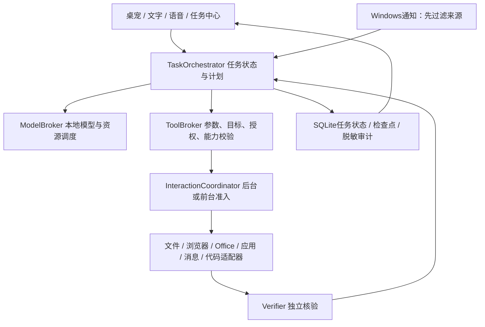

# 小K后续开发完整计划

2026-10-14 15:16更新：原24小时观察监控PID `43316`与其绑定Host PID `18660`已经消失，旧控制文件仍显示`running`且没有最终报告，因此该样本中断，不算验收通过；终止原因未知。签名安装`0.1.139.0`当前Host PID `44336`。已按附着模式对该现有Host重新开始24小时观察，监控PID `34908`、run ID `8389273628e646ec86ef4afa3cabbadd`、60秒采样，开始于`2026-10-14T07:16:26Z`、预计`2026-10-15 15:16 CST`完成；不会启动/关闭/修改Host，期间不在本机编译、测试、打包、安装或操作Host。代码候选`0.1.159.0`的完整GitHub CI通过，文档同步提交`295ffd9`已推送。R0、六类任务端到端与新24小时验收仍未完成。

2026-10-14 15:12更新：主线已推送至`e62ac4b`，候选`0.1.159.0`的GitHub Actions [Build 38526341181](https://github.com/mingkailin70-cmd/desktop-assistant/actions/runs/38526341181)全步骤成功，包含固定SDK校验、长期观察停止协议检查、Release构建、完整安全检查和桌面体验检查。恢复策略改为已知只读类别显式白名单，未知类别在动作开始后默认进入结果待核对。当前签名安装仍为`0.1.139.0`，Host PID `18660`与观察PID `43316`继续运行至`2026-10-15 05:23 CST`；观察期间没有本机编译、测试、打包、安装或操作Host。该变更不代表跨重启真实恢复、桌宠实机体验、R0或六类任务端到端验收完成。

2026-10-14 13:59更新：当前安装版仍为签名`0.1.139.0`，Host PID `18660`与附着观察PID `43316`继续运行至计划结束2026-10-15 05:23 CST；期间不在本机编译、测试、安装或操作Host。主线已推送至`6a2b034`，候选`0.1.156.0`将柯基动画主体、展开面板头像和角色文案统一，并防止活动XAML重新引用旧猫图。GitHub Actions [Build 38519004242](https://github.com/mingkailin70-cmd/desktop-assistant/actions/runs/38519004242)全Job成功：Release构建、完整安全套件、完整桌面体验套件均通过。前一候选`0.1.155.0`因拖动探针断言仍查找旧“猫图”提示而失败，已同步更新探针并完整重跑。当前版本尚未本机打包/安装；桌面外观、拖动、缩放、DPI与位置恢复仍待长观察结束后的实机验收。R0、模型准入及六类任务端到端目标均未完成。

2026-10-14 09:13：AISHELL-3 VITS候选机器锁单提交`6681fbf`已推送，锁定固定Hub revision与Sherpa归档SHA，逐项记录9个解包文件散列、运行时包锁和许可来源；本机9/9散列复核通过，候选`requiredForP0:false`且未运行。通用Hub下载器对归档获取方式显式拒绝，避免把`model.onnx`误作Hub路径或只下载主权重后宣称资产齐备。压力夹具调度修复提交`cec642f`后，GitHub Actions [Build 38494010892](https://github.com/mingkailin70-cmd/desktop-assistant/actions/runs/38494010892)全Job通过：Python检查、Release构建、完整安全检查与桌面体验检查全部成功。上一轮失败定位为并发目录搜索压力夹具未形成重叠，已通过测试观察钩子的小延迟修复；没有改生产搜索行为。本机没有运行模型、Host或测试。签名安装版`0.1.139.0`的24小时观察、桌宠拖动实机验收、AISHELL运行时/语音评估、R0门槛与首版端到端仍未完成。

2026-10-14 08:41：AISHELL-3 Icefall VITS 官方整包已下载至Git忽略目录并逐文件校验，归档SHA-256为`AB468DB3A3308CDD861495E0DB2F25D79418A0C00639F74944C7CDF5DD8C6EC1`；其中`model.onnx`散列与固定Hub revision一致，词典、tokens、说话人表及FST/rule文件共9项均有固定散列记录。AISHELL-3数据集和模型元数据标Apache-2.0，Sherpa文档说明对应174说话人AISHELL-3模型；归档未附独立LICENSE文件，因此许可判断仅依据公开模型/数据元数据。候选只进入隔离CPU评估队列，不接Host或生产路由；当前24小时Host观察仍在运行，尚未加载/启动TTS。待观察结束后核验Windows运行时兼容、资源、六句文本正确性、听感和延迟。详见[语音往返报告](../验收与评测/语音模型合成往返首测.md)与[模型选型计划](实施计划与模型选型.md)。

2026-10-14 07:56：提交`6a0788b`的GitHub Actions [Build 38486765181](https://github.com/mingkailin70-cmd/desktop-assistant/actions/runs/38486765181)通过，并实际执行应用启动期限/取消回归步骤。此证据是远端合成检查；安装`0.1.139.0`的Host PID `18660`与24小时观察PID `43316`仍在运行至预计2026-10-15 05:23 CST，真实桌面拖动与安装版启动行为尚未验收。

2026-10-14 07:50：复核发现Build `38486072967`未执行新增应用启动回归；工作流`.github/workflows/build.yml`现在加入`--only-app-launch`专用step，等待新run。其源码仍为候选`0.1.147.0`，签名安装版`0.1.139.0`和附着长期观察不变。

2026-10-14 07:49：启动窗口期限和取消边界修复提交`4c7a632`已推送，GitHub Actions [Build 38486072967](https://github.com/mingkailin70-cmd/desktop-assistant/actions/runs/38486072967)全job通过：Release构建、通知/凭证/文件搜索、任务恢复和桌面体验检查成功。后续复核确认该run未调用新增的`--only-app-launch`入口，因此未证明三条新增回归已执行；现已补CI step。版本候选`0.1.147.0`；签名安装版仍`0.1.139.0`，Host PID `18660`与24小时观察PID `43316`仍运行至预计2026-10-15 05:23 CST。本机不运行构建或测试；候选的真实应用启动和取消行为仍须安装版验收。

2026-10-14 07:31：提交`c0dcb24`的应用启动单调期限改动已推送，Build [38484040214](https://github.com/mingkailin70-cmd/desktop-assistant/actions/runs/38484040214) build job通过。主线候选`0.1.146.0`同时含桌宠窗口级拖动与收起态猫身入口；签名安装版仍为`0.1.139.0`。Host PID `18660`与24小时观察PID `43316`仍运行，预计2026-10-15 05:23 CST结束。未停止观察或替换安装；安装后真实鼠标拖动、点击展开、缩放/多屏及位置重启验收仍未完成。

2026-10-14 07:20 启动窗口核验期限改用单调时钟：源码以注入的`TimeProvider`测量启动后的窗口核验期限；合成回归模拟慢枚举耗尽期限，验证不会继续轮询或发起第二次启动。工作区候选`0.1.146.0`尚未提交/CI验证，本机不运行构建或测试，因为安装版Host PID `18660`仍被24小时观察PID `43316`监控。当前安装`0.1.139.0`；桌宠自由拖动改动在已通过CI的`0.1.145.0`源码中，尚未安装，真实鼠标移动仍待观察结束后的现场验收。

2026-10-14 07:12 收起态桌宠拖动补正提交`da6243c`已推送，GitHub Actions [Build 38482358214](https://github.com/mingkailin70-cmd/desktop-assistant/actions/runs/38482358214)通过固定SDK Release解决方案构建、完整安全与任务恢复检查、桌面体验检查。收起态`CompactPetButton`现在可拖动，静止点击仍展开；其他控件仍保留交互。该CI不代表真实鼠标验收。签名安装版仍为`0.1.139.0`，附着观察仍在运行，尚未安装或实测候选`0.1.145.0`。

2026-10-14 07:07 桌宠拖动根因复核与补正：用户希望收起态小K能像桌面宠物一样直接拖动。窗口级预览拖动已覆盖非交互区域，但收起态整只猫位于展开面板按钮中，而过滤器把所有WPF按钮排除，导致猫身本身不能拖。候选`0.1.145.0`现只放开该主体按钮作为拖动入口；轻点展开和其他控件的点击/输入/缩放行为保持。新增纯策略边界与XAML接线断言。此时等待远端CI，后于07:12通过；安装版未更换，真实桌面拖动仍待观察结束后安装验收。

2026-10-14 07:02 AISHELL-3 VITS权重来源/许可复核：OpenSLR SLR93列Apache-2.0，AISHELL提供方发布说明限定免费开放给高校科研教育机构；固定Hub卡片没列训练数据。Sherpa的AISHELL-3模型家族说明仅为间接佐证。该权重继续隔离，当前不构成本机TTS生产候选。

2026-10-14 06:36 P2 KWS故障隔离源码候选：Sherpa检测器拟在独立BelowNormal Host子进程运行，AudioGraph仍由Host负责；最多8个16 kHz单声道帧排队，每帧至多16,000个float样本，经本地重定向管道传送，Host/worker两侧清理短时缓冲。worker二次核验固定模型文件SHA-256，只接受固定“小K”标签，解码期间不访问麦克风API。Windows `KILL_ON_JOB_CLOSE` Job Object用于Host崩溃回收；正常停麦先释放AudioGraph和输入节点再关管道/终止worker。修正已启动worker之后取消造成的清理空隙，新增协议边界、关键接线检查。候选包`0.1.144.0`，代码和CI待验证；没有在当前机器构建、启用唤醒、打开麦克风、加载语音模型或打包安装。它不是OS权限沙箱，也不是误唤醒率、资源、真人语音或P2验收。附着观察PID 43316与安装Host PID 18660仍运行，预计10月15日05:23结束。

2026-10-14 06:44 提交`8ae9b1b`的远端Build `38479312053`在编译桌面体验检查时失败，GitHub check-run注释定位新增探针未显式引用`System.IO`，导致`Path`/`File`符号缺失。已补明确`using`，待新提交CI复核；没有在附着观察期间本机编译或运行检查。

2026-10-14 06:51 提交`f366cb0`的CI `38479888843`通过固定SDK解决方案构建和前12组安全/任务恢复检查，桌面体验检查失败。只读获取的GitHub日志显示KWS探针将类名`SherpaAudioGraphWakeWordListener`误判为worker直接使用AudioGraph API；现改为检查WinRT音频/麦克风具体类型与创建调用，待新CI验证。未在本机运行测试。

2026-10-14 06:56 提交`932f87a`的GitHub Actions [Build 38480648753](https://github.com/mingkailin70-cmd/desktop-assistant/actions/runs/38480648753)通过固定SDK Release解决方案构建和整套安全、任务恢复、桌面体验检查。KWS探针误报已修正。此证据限于代码构建及合成/静态检查，不是本机Sherpa启动、真人麦克风停麦、Host崩溃回收或唤醒准确率验收。当前主线源包`0.1.144.0`包含已通过远端检查的`0.1.143.0`窗口级桌宠拖动；签名安装版仍为`0.1.139.0`。观察期间未在本机运行测试或安装；观察结束后应安装`0.1.144.0`并做真实鼠标验收。

版本：规划 v1，状态更新至2026-10-14 08:21（中国标准时间；签名MSIX`0.1.139.0`和Host PID `18660`、附着观察PID `43316`仍运行，24小时观察预计2026-10-15 05:23结束。用户报告安装版不能自由移动，确认原因是其早于主线`0.1.147.0`拖动修复；收起态拖猫身、展开态拖猫图/空白区域的源码已通过Build，但新实现未安装/鼠标实测。观察期间不得本机安装或测试。提交`4772252`的GitHub Actions Build `38489215996`全Job通过：固定10.0.401 SDK装入真实`.tools\dotnet`目录，Release构建成功，完整安全套件134项通过/0跳过（含AppContainer），完整桌面体验套件成功。此为远端自动证据，不代替实机拖动。观察结束后安装最新包并集中验收拖动、点击/控件、多屏/缩放及重启位置记忆。R0通知/身份/外发闭环、模型准入、六场景端到端、语音设备、长期运行最终报告及发布/升级/回滚仍未完成。）

2026-10-14 06:23 候选`0.1.143.0`的窗口级拖动实现通过GitHub Actions Build `38476847427`。原CI编译问题均已由类型限定修复。检查没有使用本机Host，也没有打断24小时附着观察；签名`0.1.139.0`仍运行。新版实机拖动、交互控件保真、多屏/工作区、缩放与重启记忆仍未验收。

2026-10-14 06:17 `0.1.142.0`的Build `38476247105`继续报告`Selector`的WPF命名空间错误；改为`System.Windows.Controls.Primitives.Selector`，候选包升为`0.1.143.0`，等待新CI验证。实际Host/监控未动，鼠标实机验收未开始。

2026-10-14 06:12 `0.1.141.0`远端CI编译失败：`MainWindow.xaml.cs`的WPF/WinForms控件名歧义，CI run `38475407957`。已限定类型为WPF并将候选版本提升至`0.1.142.0`；未在本机重建，等待推送后的远端验证。安装版仍是`0.1.139.0`，24小时Host观察未被打断；真实拖动仍未验收。

2026-10-14 06:04 桌宠拖动入口扩展到整个非交互窗口区域：紧凑与展开状态统一接入窗口级左键预览事件，静态空白区域均可启动系统拖动；按钮、文本输入、列表、滑块、滚动条和缩放手柄不拦截。紧凑态静止点击展开，展开态静止点击保持当前模式；位移结束后限制到显示器工作区并保存位置。包版本升至`0.1.141.0`。本机`0.1.139.0` Host PID 18660仍由24小时观察PID 43316附着监控，观察结束前不启动构建/检查/Host/模型，不替换安装。源代码已作改动但尚无构建和真实鼠标证据；待推送后的远端CI，及观察结束后新版安装、拖动、多屏/缩放/位置恢复实机验收。

2026-10-14 05:39 桌宠拖动体验补口：当前0.1.139.0实机窗口的UIA树显示500×650展开任务面板；源码检查发现展开态的主视觉猫图没有拖动处理器，用户在该猫图上拖动不会移动窗口。新增展开态猫图专用预览左键处理器及`SizeAll`光标/辅助说明，移动后约束工作区并保存坐标，静止点击不触发收起；紧凑态仍支持任意可见区域拖动和轻点展开。纯交互策略测试扩展为区分“紧凑态点击可展开”与“展开态猫图点击不切换”的行为，包版本源改为`0.1.140.0`。

尝试在安装版上真实拖动一次，但Computer Use报`failed to activate captured window`；刷新应用/窗口选择后再尝试激活仍失败。故没有真实位移证据，也没有继续输入。提交`4233972`已推送，GitHub Actions Build [38472419914](https://github.com/mingkailin70-cmd/desktop-assistant/actions/runs/38472419914)成功：固定SDK `10.0.401` Release全解构建、工作流中的定向安全检查和完整桌面体验检查通过；本机完整安全套件未重跑，以免干扰附着观察资源样本。当前0.1.139.0 Host PID `18660`仍运行于24小时附着观察中；不安装/重启新Host以保留这轮数据。`0.1.140.0`源码修复仍待本机打包安装、真实鼠标拖动与坐标重启恢复验收。

2026-10-14 05:24（中国标准时间）对当前`0.1.139.0`启动24小时附着观察，Host PID `18660`、监控PID `43316`、run ID `5d0d6afd8b754dbfb8d609814d97d7d5`，每60秒采样，预计2026-10-15 05:23结束。该工具先通过1分钟冒烟：4/4样本可见/响应，0间隔缺口、0计数器失败。正式报告未完成；附着观察可以反映当前Host在日常会话中的长期响应与资源表现，但不强制全程可见，因此不能将它当作完整“可见空闲”或端到端验收。

2026-10-14 05:15 桌宠人工拖动激活策略修正并安装`0.1.139.0`：用户反复反馈桌宠无法自由移动。历史记录表明`0.1.128.0`已经用过WPF `Window.DragMove()`，但紧凑态同时用`WM_MOUSEACTIVATE/MA_NOACTIVATE`阻止人工鼠标激活；本次实际只读窗口扩展样式没有发现`WS_EX_TRANSPARENT`点击穿透位。于是保留WPF标准拖动入口，去掉人工鼠标按下时的`MA_NOACTIVATE`拦截，并在XAML把`ShowActivated=false`固定为首次显示策略：启动不抢前台，用户主动操作桌宠时允许系统正常激活。后台任务路径没有新增激活调用。该激活冲突是根据历史实现和当前样式作出的修复假设，仍需真实鼠标验收确认。

固定SDK `10.0.401` Release全解决方案构建0警告、0错误；完整安全检查134项通过、0跳过；桌面体验检查109项通过。签名MSIX `artifacts/msix-validation/7a88fa4ec5b74c86950a57a4741c8d97/XiaoK-signed-validation.msix`大小155,799,189字节，SHA-256 `35BA312C9C876D15A052DE8267A9D1952F8C4928A30AD30C18081F6C318F724A`，SignTool验签0警告/错误，证书信任未变。安装前Host PID 19120正常退出，当前账户安装`0.1.139.0`、状态`Ok`，AppX入口启动Host PID 18660；窗口可见且非前台，安装版/发布版Host DLL SHA-256均为`C01CDFA1F93C39B9D766459A13D237D3E2A70E86BD264FF7D2C13905A52D4BBD`。即时回滚包`0.1.138.0`位于`artifacts/msix-validation/915a3ff5c40f479e9ed3510f6f285f5c/XiaoK-signed-validation.msix`，SHA-256 `DD53EC8142808A58E2419344829FBB25EE8D396230171C985F08F22A945B79F6`。本机工具仍无法真实拖动窗口；移动、短按展开、缩放、多屏和位置重启恢复未计实机通过。

2026-10-14 05:05 桌宠拖动改用 WPF 标准窗口移动入口并安装`0.1.138.0`：用户再次反馈桌宠不能随意移动。`0.1.137.0`的紧凑桌宠将`WM_NCHITTEST`改为`HTCAPTION`，但静态/合成检查没有覆盖透明窗口上真实鼠标按下路径，因此不能证明实际可拖动。本次在`PetView`预览左键事件中对除缩放手柄外的任意可见区域直接调用WPF `Window.DragMove()`，交给系统移动循环跟随鼠标；松开后窗口有位移则限制在当前显示器工作区并保存，无位移则展开任务面板，取消不会展开。保留`MA_NOACTIVATE`、右下缩放、右键菜单、Ctrl+滚轮和位置持久化。

固定SDK `10.0.401` Release全解决方案构建0警告、0错误；完整安全检查134项通过、0跳过；桌面体验检查109项通过。签名MSIX位于`artifacts/msix-validation/915a3ff5c40f479e9ed3510f6f285f5c/XiaoK-signed-validation.msix`，155,799,237字节，SHA-256 `DD53EC8142808A58E2419344829FBB25EE8D396230171C985F08F22A945B79F6`；SignTool验签0警告、0错误。证书`B96A02547ABA84523619E11EB7788AE9850A5C60`此前已受信，本次未改信任。安装前Host PID 65452正常退出；当前账户安装`0.1.138.0`、状态`Ok`，AppX入口启动Host PID 19120；窗口可见、非前台，安装版/发布版Host DLL SHA-256均为`0073AF608003E587DADB88A74850990A2368F79ED552D53835850343694D33A2`。回滚包`0.1.137.0`保留于`artifacts/msix-validation/3463208ce2fb47df8eafafbbd341eaed/XiaoK-signed-validation.msix`。当前自动化没有真实鼠标输入，因此不能宣称拖动或跨屏已实机通过；R0、首版六场景和长期观察状态不变。

2026-10-14 04:34 桌宠自由移动入口重构并安装`0.1.137.0`：针对用户反馈原移动方式仍不可靠，源码将紧凑态桌宠主体命中测试改为Windows原生`HTCAPTION`，系统移动循环跟随拖动；缩放手柄保留客户端命中。不激活前台的`MA_NOACTIVATE`保留，原生移动结束后根据实际位置变化保存坐标，未移动短按则展开，取消不触发展开；右键上下文菜单与Ctrl+滚轮缩放仍可用。移除全局钩子、16ms轮询和逐帧`SetWindowPos`拖动。固定SDK Release全解构建0警告/错误，桌面体验109项通过。

签名MSIX `0.1.137.0`为155,800,381字节，SHA-256 `89B12166AE98BD490A5389E874E81183470AFD115290F178109617AF63C18A59`，SignTool 0警告/错误；证书`B96A02547ABA84523619E11EB7788AE9850A5C60`原已受信，本次未改信任。旧Host PID 70036经核验正常退出，当前账户安装状态`Ok`，AppX入口启动新Host PID 65452，窗口可见且非前台。安装/发布版Host、Tools散列一致；`llama-server`为0。回滚包`0.1.136.0`保留于忽略目录`artifacts/msix-validation/0d1ee5f741364a4c9614f47946871d57/XiaoK-signed-validation.msix`。环境无法发出真实鼠标动作，故实际拖动、轻点、缩放、多显示器和重启位置仍待真人确认。R0、首版六场景端到端和其他长期验收不变。

2026-10-14 04:13 CodeAgent有限凭证格式规则交付安装版：签名MSIX `0.1.136.0`为155,801,834字节，SHA-256 `F83D982C149670A9F35510ABD2628D1B2B4667C6A0643F7496288F692A4790B1`，SignTool 0警告/错误；安装前Host PID 50904正常退出，当前用户安装状态`Ok`，AppX启动Host PID 70036，窗口可见且非前台。安装版`XiaoK.Tools.dll`与发布输出散列匹配；通知/唤醒仍关闭，llama-server为0。CI对提交`566fda7`的全解构建、安全检查134项、桌面体验109项均通过。真实模型运行、真实项目AppContainer还原/测试和真实凭证覆盖仍待；当前安装包不证明这些场景验收通过。回滚包`0.1.135.0`及哈希见[MSIX打包说明](../开发与发布/MSIX打包说明.md)。

2026-10-14 03:51（中国标准时间）用户再次报告桌宠无法自由移动。定位到`MA_NOACTIVATE`使小K处于非前台时，`GetAsyncKeyState(VK_LBUTTON)`可能因前台线程属于其他进程而返回0，导致16ms轮询提前结束手势。现在只在桌宠按下期间临时装低级鼠标钩子接收左键释放；回调只投递窗口消息并调用后续钩子，窗口坐标仍在UI定时器中更新。释放、取消、关闭即卸载。短按展开、缩放、屏幕物理坐标、工作区限制、位置保存和不抢焦点行为保留。Release构建0警告/错误，桌面体验109项通过。签名MSIX `0.1.135.0`已安装并正常启动，Host窗口可见且非前台；安装版/发布版Host散列一致。回滚包`0.1.134.0`保留。由于本环境没有真实鼠标输入，真实拖动/轻点/缩放/多屏及重启恢复不计通过。

2026-10-14 03:24 R3安装版内容搜索实目录核验：对签名MSIX `0.1.134.0`核对Windows适配器/Core程序集散列与本地验证副本一致后，在设置已授权的`src\XiaoK.Host`子目录搜索一个指定代码符号，命中预期文件且仅返回路径/行号，132.5 ms；验证摘要不回显搜索词、结果行仅含范围内路径和行号。对未配置的盘符根`D:\`执行前置拒绝，退出码2且未搜索。控制台未输出查询、路径、行号或正文，未启动Host/llama-server或改变设置。全解决方案Release构建0警告/错误；最终诊断代码的定向Release重建0警告/错误。该证据只覆盖一个授权项目子目录和边界拒绝；任务中心界面、并发编辑、完整目录性能和首版六场景仍待验收。

2026-10-14 03:04 桌宠拖动稳定性修复：移除按下期间的`WH_MOUSE_LL`全局鼠标钩子，改为仅在宠物按住期间运行16ms UI轮询，读取当前指针物理屏幕坐标和左键状态；在系统阈值后移动窗口，释放后停止轮询、约束工作区并保存。保留不激活前台、短按展开、右下缩放和多屏负坐标策略。构建0警告/错误，桌面体验109项及完整安全检查134项通过。签名MSIX `0.1.134.0`已安装并运行，安装版程序集散列匹配发布输出，通知/唤醒设置保持关闭。由于没有原生鼠标控制，本机没有实际拖动证据；仍需真实鼠标验收。

2026-10-14 02:48 已安装版文件名搜索诊断：使用签名包`0.1.133.0`，在设置已授权的`src\XiaoK.Host`子目录命中`Package.appxmanifest`，90.6 ms。安装版适配器/Core散列与本机验证包副本一致；诊断没有输出路径/正文、启动Host或改设置。提交`e8a4a13`的GitHub Actions Build [38449084884](https://github.com/mingkailin70-cmd/desktop-assistant/actions/runs/38449084884)所有步骤通过。该单子目录命中不代替无命中、权限/取消UI、用户目录性能或六类任务端到端验收。

2026-10-14 02:41 R3目录取消修复封装安装为`0.1.133.0`：签名MSIX 155,802,860字节、SHA-256 `E1DAF32F9BA140ECE0A323084E4A89FD853A84F808B6DCCAB981DA4564D67302`，SignTool 0警告/错误；证书信任未变。旧Host PID 31368正常退出，当前账户安装状态`Ok`；安装版/发布版Host DLL SHA-256相同，为`C3F28E1EA7248C6676B0C5E9885C72E2C8B96E0422FA417A18BCB0D4E91E8560`，Windows适配器DLL散列也一致。正常AppX启动唯一Host PID 12040，窗口可见且不是前台窗口。启动前微信/QQ通知、唤醒词关闭，发布者列表为空。即时回滚至`0.1.132.0`的签名包仍保留。安装确认不替代真实用户文件任务、取消UI或首版端到端验收。

2026-10-14 02:33 R3文件搜索取消响应加固：共享Windows目录枚举器在同步目录查询前后和解析每条记录时检查取消，覆盖文件名搜索、内容搜索、目录归档与文件分类。512项合成目录在解析第64项时触发取消，断言立即退出而未收集其余记录；同步本机API调用本身不能被打断，返回后即检查取消。固定SDK Release全解0警告/错误，完整安全检查134项通过、0跳过；其中既有48路并发搜索与1,201项批量目录压力路径也完成。只使用合成数据，未打包安装；R0及首版端到端门槛不变。

2026-10-14 01:54 桌宠自由拖动再修复并安装`0.1.131.0`：用户再次反馈无法移动，移除WPF子树鼠标捕获与预览移动/松开路由，左键按下改用Win32 `SetCapture(hwnd)`；窗口钩子跟踪`WM_MOUSEMOVE`、`WM_LBUTTONUP`及捕获变化/取消，按屏幕物理坐标增量调用`SetWindowPos(SWP_NOACTIVATE|SWP_NOZORDER)`。阈值内短按松开仍展开，缩放把手排除，结束时工作区约束并保存。固定SDK Release全解0警告/错误，安全检查134项、桌面体验109项通过。签名MSIX `0.1.131.0`大小155,800,726字节、SHA-256 `23E7F46749F73107C490D4FA1F4B810FCAD888E2987E6CC03E89A95316E5F3A5`，SignTool 0警告/错误，证书`B96A02547ABA84523619E11EB7788AE9850A5C60`此前已受信且未改信任。旧Host PID 72300正常退出；当前安装状态`Ok`，经AppX启动Host PID 20852。安装版/发布版Host DLL散列相同：`40A45D16E47EDD069969EB10484E660865DE98529B242FAC63EF13670A7279E8`。窗口可见、Topmost、不是前台窗口，探针期间前台句柄不变；通知/唤醒设置关闭、发布者名单为空，`llama-server`为0。`0.1.130.0`回滚包散列`8243AB308EB51F463F43599DB8E81A25440AF5B273A9284435DE79BDC671B432`。本会话没有原生桌面鼠标输入，实际拖动、轻点、缩放和位置重启恢复仍未验收；R0与首版端到端状态不变。

2026-10-14 01:32 R3文件名搜索部分结果与稳定排序：搜索遇到无法打开/变化目录、重解析点或最大深度时虽安全跳过，但此前未告知用户可能漏项。本次将跳过项、最大深度和扫描上限纳入摘要，明确提示结果可能不完整；配置根与目录项排序固定，搜索范围、拒绝重解析点、10条结果上限、5,000项扫描上限和5层深度保持不变。安全套件新增纯策略、合成深层目录、稳定顺序及目录联接提示断言。固定SDK Release全解0警告/0错误，安全检查134项通过/0跳过，桌面体验109项通过；同次运行的48路并发搜索完成4次联接切换且未越界（55 ms），1,201项目录的多批次搜索4 ms。签名MSIX `0.1.130.0`大小155,800,961字节，SHA-256 `8243AB308EB51F463F43599DB8E81A25440AF5B273A9284435DE79BDC671B432`，SignTool 0警告/0错误，证书信任未改变；安装状态`Ok`，安装版/发布版Host DLL SHA-256均为`80B3049E38A0DF3734363751A0F16234193D75D3CCB3838001BC7B9828095697`。安装后没有自动启动Host；受限诊断完成后从AppX正常启动Host PID 72300，窗口可见、Topmost且启动前后前台句柄不变，llama-server为0。安装包匹配诊断副本在授权项目子目录命中/无命中耗时57.5/69.0 ms，仅输出状态和耗时。此项仍不是文件任务UI、拒绝访问/取消、真实大目录或首版端到端验收。

2026-10-14 01:11 桌宠拖动复修并安装0.1.129.0：用户反馈旧版仍无法自由移动。已安装`0.1.128.0`使用原生`DragMove()`，并没有真实鼠标验收；源码改为`PetView`预览按下/移动/抬起及失去捕获处理，捕获桌宠子树后按物理指针坐标增量调用`SetWindowPos`。系统阈值内松开仍展开任务面板，右下缩放手柄排除，拖动跨屏时暂缓额外DPI约束，结束时约束和保存。固定SDK Release全解0警告/0错误、桌面体验109项、安全检查134项通过。签名MSIX `0.1.129.0`为155,800,367字节，SHA-256 `5145CC39DD6C2E7F75160DD469406A9075B4C89BE5BA8603D00AB392CF0989C1`，SignTool 0警告/0错误；安装版/发布版Host DLL SHA-256均为`042C8F8DAA2B0D0F44CA4D003E179D89A5106C0240E5BCF381A23B887C9E10A1`，证书信任未改，旧Host正常退出后新版PID 57780启动。没有原生鼠标控制，真实拖动、轻点及位置重启仍未验收。

2026-10-14 00:50 P2语音诊断：锁定Qwen3-TTS-CustomVoice在独立BelowNormal双线程CUDA工作进程完成六句TTS/CPU ASR，去标点匹配6/6；TTS p50/p95 6.36/8.83秒、ASR 1.62/2.65秒，RAM最低4,321 MiB、VRAM最低空闲2,914 MiB。单句生成依然慢于音频播放时长，GPU结果只属隔离性能筛查。随后使用当前安装包`0.1.128.0`的`VoiceInferenceService`和`ModelBroker`运行CPU冷/暖合成转写与两分钟空闲恢复诊断，匹配3/3、卸载后恢复成功、结束时语音Worker为0。没有麦克风/扬声器设备调用；P2未通过，GPU推理尚未接入Host生产路由。完整样本限制和仓库外报告见[语音往返报告](../验收与评测/语音模型合成往返首测.md)。

2026-10-13 23:47（中国标准时间）桌宠自由移动修复版安装成功：安装器此前两次返回Win32 1168。复核定位为无BOM UTF-8 PowerShell脚本中的中文窗口标题被Windows PowerShell 5.1按系统代码页解码，严格标题匹配因而失败。现改用ASCII脚本中的Unicode码点构造同一标题，PID、映像路径和精确窗口标题核验仍保留，升级只请求正常退出、不强杀。Windows PowerShell 5.1解析和安装器契约定向检查通过；安全检查项目Release构建0警告/0错误。官方安装器正常关闭旧Host并安装、启动签名MSIX`0.1.128.0`；包SHA-256为`B5C68D5CC9DE84003D4C99D4DB8E6194D4AD79E07E1441DDA6837E89CDE22B8B`，SignTool验签0警告/0错误且证书信任未变，安装版与发布版Host DLL SHA-256均为`197E1EC2204CB5490BBB014322CFABF50A72DAB7E7E5955A9479B94341AA7EBA`。只读Win32探针确认窗口可见、Topmost生效且非前台窗口，`llama-server`未运行。不能使用鼠标的当前计算机接口未能验证真实拖动、短按或位置重启恢复；因此修复仍待现场验收，0.1.128.0的24小时观察也未开始。

2026-10-13 23:27（中国标准时间）针对用户仍无法自由移动的反馈，改用 WPF 原生 `Window.DragMove()` 代替透明 Thumb 捕获层加手工 `SetWindowPos`，并将紧凑桌宠设为置顶、展开任务面板时回到普通 Z 序；不移动的短按展开，右下缩放把手保留，拖动结束仍工作区约束并保存位置。推测旧方案的自定义捕获/手工位置处理和普通 Z 序导致体验不可靠；此为代码复核推断，不能宣称已由真实鼠标复现证实。固定SDK Release全解决方案构建0警告/0错误、安全套件134项通过/0跳过、桌面体验检查109项通过。签名`0.1.128.0`候选为155,797,686字节，SHA-256 `B5C68D5CC9DE84003D4C99D4DB8E6194D4AD79E07E1441DDA6837E89CDE22B8B`，SignTool验签0警告/0错误；安装器两次未能完成旧Host的已核验正常退出请求，均以Win32 1168失败关闭，未安装/改信任，当前仍为`0.1.127.0`、PID 59092。候选包位于忽略目录。真实鼠标操作仍待安装后由交互式桌面验收。

2026-10-13 22:59（中国标准时间）P3已安装版项目子目录文件名搜索实测：只读诊断确认当前账户签名MSIX为`0.1.127.0`且状态`Ok`，读取安装包适配器与Core散列并与同版本本地验证包副本一致；再确认`D:\Desktop\learn\siri\src\XiaoK.Host`是现有设置中已配置搜索根内的普通目录，通过已安装版`SearchFilesAsync`查找根部`XiaoK.Host.csproj`，命中，耗时30.9 ms。诊断不输出路径或文件内容，没有启动新Host、改变设置或写入文件。该证据只覆盖一个项目子目录的文件名搜索，不代表更大真实目录、并发编辑、普通UI、权限/取消或端到端任务验收。

2026-10-13 22:37（中国标准时间）桌宠自由移动交互升级：`0.1.126.0`的移动已改用`SetWindowPos`，但仍依赖与按钮共用的预览事件和自定义捕获，只有合成检查，用户仍反馈不能拖动。本次改用覆盖桌宠本体的透明WPF `Thumb`拖动层，使用内置系统拖动阈值与捕获；按屏幕物理光标位移移动窗口，并防止拖动激活小K。短按在Thumb鼠标事件完成后独立展开任务面板，缩放手柄置于拖动层上方，右键菜单保留；松手约束工作区并保存位置。固定SDK Release构建0警告/0错误，安全134项和桌面109项通过；签名MSIX `0.1.127.0`已安装并启动，包散列和Host DLL散列见开发进度。此会话不能物理操作原生鼠标，故真实拖动/点击/位置重启测试仍待用户桌面验收，不能以合成结果宣称通过。

2026-10-13 21:34（中国标准时间）安装器目标窗口核验修订CI通过：提交`40ff737`已推送，GitHub Actions [Build 38405488377](https://github.com/mingkailin70-cmd/desktop-assistant/actions/runs/38405488377)全部成功，本地安全套件134项通过、0跳过。当前会话仍不能成功投递已验证Host窗口的优雅退出消息，故没有安装`0.1.126.0`；不强杀、不绕过核验。桌宠新拖动逻辑的真实鼠标与位置重启验收继续待可交互窗口。

2026-10-13 21:29（中国标准时间）MSIX安装器目标窗口核验增强：安装器现从已经按已安装包路径核验的Host进程获取主窗口句柄，并在发送固定优雅关闭消息前复核窗口PID和精确标题，不再依赖全局窗口枚举。新增固定安全套件静态契约检查；PowerShell语法解析通过，完整安全套件134项通过、0项跳过。本机再次使用此路径时仍返回Win32 1168，未安装或更改信任，PID 52800仍运行`0.1.125.0`。这项增强保持失败关闭，但没有解决当前桌面会话无法安全向该窗口投递消息的问题；新版桌面交互与首版验收仍未通过。

2026-10-13 21:19（中国标准时间）桌宠移动修复代码阶段完成：提交`373460a`已推送至`origin/main`，GitHub Actions [Build 38403431753](https://github.com/mingkailin70-cmd/desktop-assistant/actions/runs/38403431753)完整成功。流水线包含锁定模型检查、Release构建、安全检查、凭证/通知/文件搜索边界、任务恢复及桌面体验检查。签名候选`0.1.126.0`因安装器无法按唯一窗口标题定位正在运行的旧诊断Host而未安装；未更改证书信任、未强杀进程。此代码阶段通过不等于桌宠实机、长期驻留或首版验收通过。

2026-10-13 21:13（中国标准时间）升级至桌宠拖动修复版的安装脚本安全退出：候选签名与散列核验成功，但`tools/install_xiaok_msix.ps1 -Install`按进程映像找到旧Host后，未能匹配唯一窗口标题，返回Win32 1168并在发送关机请求/改包之前停止。PID 52800仍运行旧版`0.1.125.0`；未强杀进程、未改信任或包。桌面自动化接口在当前会话未提供原生窗口句柄，所以没有继续绕过窗口身份门槛。0.1.126.0候选保留待交互桌面正常退出旧Host后再安装和真实验收；这不改变本计划的代码级检查结果，也不代表桌宠首版交付。

2026-10-13 21:08（中国标准时间）桌宠移动改为屏幕光标直接跟随：上一版在预览鼠标移动越过阈值后仍调用`Window.DragMove()`，窗口内层按钮的鼠标捕获可能使调用无效，而`InvalidOperationException`被静默忽略，导致“能判定开始拖动”但不保证窗口实际移动。现记录按下时的光标物理像素和窗口原点，越过系统拖动阈值后通过`SetWindowPos`按屏幕光标差值更新位置；保持轻点展开、排除缩放把手、保留多屏工作区约束，松手或丢失鼠标捕获时保存位置。新增跨屏负坐标与溢出检查。固定SDK `10.0.401` Release全解决方案构建0警告/0错误，桌面体验检查109项通过，完整安全检查134项通过、0跳过。首次安全检查暴露通知样本静态断言未随`_publisherInspectionFailed`新增的采集保护更新；修正断言后全套通过。签名MSIX `0.1.126.0`候选包155,799,344字节，SHA-256 `415BA46A2704224B5C6CD4D0B7772C5AF5A125BD17CDD5EF2DDB4A0300A8FF8D`，Host DLL SHA-256 `C932E5D7068FC7DD40024E9CC1DA6119869CBB11E2C5D9668FAF1CA6B9387633`，SignTool 0警告/0错误，证书信任未变；候选位于忽略目录`artifacts/msix-validation/7c89382ef98649a7a053ff3b54b396a3/XiaoK-signed-validation.msix`。当前旧版`0.1.125.0`诊断Host PID 52800仍运行，未终止/覆盖安装或启动第二实例；故新版实机拖动与24小时观察未完成，不能标记桌宠交付。R0及六场景首版端到端仍未通过。

2026-10-13 20:29（中国标准时间）长时观察协作停止能力：提交`45e8762`为`tools/measure_xiaok_long_run.ps1`增加每轮唯一控制文件/命名事件，提供`tools/request_xiaok_long_run_stop.ps1`校验运行ID、控制目录和监控/Host进程启动时间后请求优雅关闭，不杀进程并保留带`observationCompleted=false`的部分报告。三个PowerShell脚本解析检查和合成停止回归11项通过；新增检查已纳入GitHub Actions，[Build 38397980629](https://github.com/mingkailin70-cmd/desktop-assistant/actions/runs/38397980629)全流程成功。测试未启动Host。当前诊断Host PID 52800仍运行，修复版24小时观察仍待实际桌面交互验收和Host空闲后启动；此工具改进不等于长时运行或首版通过。

2026-10-13 20:09（中国标准时间）桌宠拖动手势的边界抗压检查：为已提交的拖动手势补充确定性边界矩阵，覆盖系统阈值临界、正负方向、单轴触发、无效系统阈值回退、按键释放和显式状态重置。固定SDK `10.0.401`本机桌面体验检查109项通过；提交`abd107e`的GitHub Actions [Build 38394766552](https://github.com/mingkailin70-cmd/desktop-assistant/actions/runs/38394766552)成功。当前0.1.125.0隔离诊断Host仍运行，但位置存储文件尚不存在，实机拖动/轻点和位置记忆仍待桌面鼠标验证；旧0.1.124.0长时观察无最终报告，修复版24小时观察尚未开始。本检查不改变拖动实现，也不替代实机验收。

2026-10-13 19:55（中国标准时间）桌宠随处拖动修复版打包安装：用户反馈原安装版无法自由移动。根因是旧WPF实现监听冒泡按下事件，宠物内层按钮先处理鼠标事件，外层收不到拖动起点；源码已由`c41bdb1`改为预览事件+系统拖动阈值，轻点展开保留、缩放手柄排除并继续保存/约束坐标，按钮路由探针由`14aebf3`补齐。两个提交的GitHub Actions [Build 38384158563](https://github.com/mingkailin70-cmd/desktop-assistant/actions/runs/38384158563)和[Build 38385993910](https://github.com/mingkailin70-cmd/desktop-assistant/actions/runs/38385993910)成功。为不让用户继续等待，旧`0.1.124.0`的24小时观察提前中断，未生成报告，不能算通过；随后本机按锁定SDK `10.0.401`发布，安装签名`0.1.125.0`。包155,798,068字节、SHA-256 `AD0AE214617A8D78862B885AA787833C7201C48C0644E2F7894EA5C39AB0BB1C`；SignTool 0警告/0错误，证书信任未变；安装版/发布版Host DLL SHA-256均为`182DECE9D0FD8DBABB5268BB7585FCDAB61AF6AED8C4EC5A6EA7A3CF65202EF4`。隔离诊断桌宠已显示、响应且未抢前台。真实鼠标拖动/轻点、多屏/缩放、重启位置记忆仍待验收；验收后需在`0.1.125.0`上重新进行24小时观察，不把旧版中断片段算入。

2026-10-13 19:42（中国标准时间）R1任务历史未知类别显示修正：未知非空任务类别不再误标为“本地对话”，统一使用固定“未分类任务”标签且不显示原始分类字符串；空值仍兼容既有对话历史。新增合成桌面体验断言，提交`817befd`对应GitHub Actions [Build 38391492753](https://github.com/mingkailin70-cmd/desktop-assistant/actions/runs/38391492753)成功。本机未构建或测试。桌宠自由拖动源码虽已修复并由此前CI验证，但尚未进入安装包；0.1.124.0的24小时可见空闲观察仍运行，0.1.125.0待观察结束后打包、签名、安装及实机拖动/点击/缩放/跨屏/位置记忆验收。此状态不代表桌宠或首版交付完成。

2026-10-13 19:35（中国标准时间）R1任务中心范围显示补齐新建文件和隔离浏览器全部类别：五类固定导出文件明确目标为小K导出目录且不覆盖；隔离浏览器打开、导航、只读快照、当前快照内同源链接/非提交按钮/普通文本框和会话关闭，分别声明其目标与无登录态、无用户Edge/桌面前台交互限制。矩阵检查覆盖12个任务类别，提交`1504f37`的GitHub Actions [Build 38390454218](https://github.com/mingkailin70-cmd/desktop-assistant/actions/runs/38390454218)唯一作业成功。未运行本机Host或实际网页会话；安装版任务中心目视仍待。

2026-10-13 19:24（中国标准时间）R1应用界面任务历史信息补齐：为应用状态查询、只读界面检查、控件等待和后台文本填写增加明确分类、目标范围与执行模式；补充应用窗口歧义/消失、控件歧义、等待失败、前台占用、写入前焦点变化和受限应用的恢复指引，并补上此前缺失的`app-ui-set-text`固定标签。提交`0603589`的GitHub Actions Build [38389543378](https://github.com/mingkailin70-cmd/desktop-assistant/actions/runs/38389543378)固定全流程成功。检查只覆盖合成任务历史策略与桌面代码路径，没有本机Host或真实UIA交互；普通任务中心目视、真实用户任务及跨重启验收仍待。

2026-10-13 19:14（中国标准时间）为桌宠拖动修复准备可升级安装版本：`Package.appxmanifest`版本从`0.1.124.0`升至`0.1.125.0`，提交`c2b9bda`已推送，GitHub Actions Build [38388369719](https://github.com/mingkailin70-cmd/desktop-assistant/actions/runs/38388369719)固定全流程成功。当前账户仍运行`0.1.124.0`的24小时观察（PID 72744、Host PID 13776）；没有本机构建、签名、安装或真实拖动测试。此提交只让待发布源码具备升级版本号，不代表新包已交付；观察结束后仍须打包安装并实测拖动、点击展开、缩放、屏幕边界和位置记忆。

2026-10-13 19:06（中国标准时间）R1应用启动阶段核验失败分类：`WindowsDesktopTools.LaunchAsync`原先会把进程启动之后发生的可预期窗口核验异常误报为`APP_LAUNCH_FAILED`，可能让用户重试。现在预检异常明确说明没有发出启动请求；启动器返回句柄后的窗口核验异常进入`APP_LAUNCH_OUTCOME_UNCERTAIN`并要求人工核对、不自动重试。新增合成控制器在启动前/启动后分别抛错的回归，并补齐历史恢复指引中的应用、窗口与只读状态错误分类。提交`c0be6b2`对应GitHub Actions Build [38387408159](https://github.com/mingkailin70-cmd/desktop-assistant/actions/runs/38387408159)完整成功。24小时观察期间未本机构建/测试/安装；普通用户会话中的应用启动与安装版历史仍待验收，不代表该场景或首版通过。

2026-10-13 18:52（中国标准时间）桌宠拖动WPF事件路由回归：提交`14aebf3`新增STA线程合成`Border`/`Button`事件路由探针，确认父容器先收到预览左键、Button随后确实收到已处理的左键事件、父容器不会收到按钮处理后的事件。固定GitHub Actions Build [38385993910](https://github.com/mingkailin70-cmd/desktop-assistant/actions/runs/38385993910)完整工作流成功。未显示WPF窗口或注入系统输入；签名安装版`0.1.124.0`的24小时观察仍运行，本机未构建/测试/安装。源码修复尚未进入安装版，真实鼠标拖动、轻点展开、缩放手柄、跨屏位置和重启恢复待观察结束后实机核验。本探针仅证明合成事件路由，不代表首版或桌宠验收通过。

2026-10-13 14:36 R0可见正文聚合资源边界：`WindowsNotificationMonitor`不再用`string.Join`先完整复制Toast文本再检查长度；新策略最多聚合20,000个UTF-16字符、256个元素，超限后立即停止并返回固定标记，由现有策略拒绝分析正文。合成边界与10,000元素惰性压力检查加入通知定向入口；提交`9e69f16`的GitHub Actions run `38357299991`固定SDK构建、通知/凭证边界与桌面体验检查全通过。当前会话分类器仍未接入，真实正文读取器继续被门控，本阶段没有读通知正文或在本机启动Host；R0/端到端验收未通过。

2026-10-13 14:24 CodeAgent源码上下文凭证边界加固：新增未加引号敏感键及`Authorization`/`Proxy-Authorization` Bearer、Basic形式的启发式脱敏，匹配超时后失败关闭，并通过合成CI边界检查。提交`13a496f`首轮CI失败，公开检查页只显示步骤退出码、没有根因日志；复核发现并修正一处测试夹具缺陷。提交`73506c1`的run `38356251504`中锁定模型、固定SDK Release构建、通知边界、凭证边界和桌面体验检查全部成功。未在本机测试、构建、打包或启动Host，0.1.124.0的24小时观察仍运行。该检测不覆盖未知格式，也不改变生产模型/权限/通知状态；R0和六类首版端到端验收仍未完成。

2026-10-13 13:59（中国标准时间）R0一次性Toast样本内存边界加固：基线键及已见键去重集合各新增4096项容量上限；基线超限时停止并不开始样本采集，新通知键超限时在正文读取前停止，现有样本仍按原15分钟期限清除。新增10000键合成压力断言和Windows CI定向检查；提交`041a3bb`的Actions run `38353986371`中构建、定向检查与桌面体验检查全部成功。为避免干扰0.1.124.0的24小时可见空闲观察，没有本机运行、构建或安装；此次源码未进入当前安装版。该项只证明有界跟踪与合成回归，不构成自然微信通知/私聊身份或端到端验收证据。

2026-10-13 13:36（中国标准时间）R1任务中心刷新结果诚实性加固：`RefreshAsync`现返回是否确实完成一次刷新。取消/审批回调异常后，只有刷新成功才显示“状态已刷新”；加载失败、刷新正在进行或窗口生命周期取消时，提示“状态尚未确认，列表可能显示旧状态”，要求人工核对，不自动重试/重放。真实离屏XAML探针覆盖取消回调与历史加载同时异常、审批回调异常后刷新成功，并检查不泄漏异常详情。提交`ca362dc`已推送，GitHub Actions run `38351997435`的锁定状态检查、固定SDK Release构建和桌面体验检查全部通过。24小时观察仍在运行；未打包、未安装，未完成人工目视、真实任务取消/审批或跨重启验收，因此R1及首版仍未完成。

2026-10-13 13:35（中国标准时间）更正QQ Bot官方接口时效判断：当前腾讯QQ机器人文档（变更记录更新至2026-09-16）明确支持机器人C2C主动消息，并列出用户主动与机器人对话后30天内的分段互动召回；发送接口使用`user_openid`，该标识按Bot区分。此前“主动推送自2025-04-21起不再提供”的判断来自过时页面，已撤回。此更正不改变R0：QQ Bot仍以机器人身份和Bot专属OpenID收发，不满足用户个人QQ账号向好友K发送的首版要求；未创建机器人、获取凭证或发送消息。来源见[GitHub开源项目借鉴记录](../开发与发布/GitHub开源项目借鉴记录.md)。

2026-10-13 12:40（中国标准时间）P2长期运行观察进展：`0.1.124.0`已启动24小时可见空闲观察，当前Host和监控进程仍在运行，预计2026-10-14 12:29结束。观察使用隔离诊断配置，不连接模型、不启用麦克风/通知监听，数据写入Git忽略目录。提交`97266a6`加固未来观察的采样完整性判定：缺样、采样间隔过长、窗口隐藏、Host无响应样本或RAM/GPU计数器缺失会判失败；本轮进程已载入旧脚本，继续运行且最终按实际报告人工判读。该观察只覆盖可见空闲驻留，不代表8小时工作负载、睡眠恢复或整体验收；此提交的GitHub Build仍在运行。

2026-10-13 11:10（中国标准时间）P2桌宠姿态反馈实现：将状态到四种姿态的映射集中管理，VPet初始化失败时回退PNG也切到对应状态图；姿态实际变化后，在元素可见、窗口未最小化且Windows客户端动画已开启时，播放总长340毫秒、单轴最大缩放2.4%的短过渡，结束后恢复基准变换，不增加常驻动画时钟。桌面体验检查覆盖状态映射、资源存在、幅度限制、系统动效/可见性门控，以及不激活离屏WPF动画的中途变化和恢复；最终103项通过。固定SDK `10.0.401` Release全解决方案构建0警告、0错误；安全套件未重跑。本改动未打包安装，故尚无普通桌面、透明合成、DPI或实际任务状态时序验收证据。

2026-10-13 10:57（中国标准时间）P3已安装版文件名搜索适配器子目录核验：RuntimeDiagnostics新入口先核验MSIX身份/版本、适配器/Core散列及当前账户配置的搜索根，再用与安装包逐字节一致的本地验证包副本，只在一个授权子目录中调用实际Windows文件名搜索适配器。对`D:\Desktop\learn\siri`查找根部`XiaoK.sln`首次命中耗时199.0毫秒；完成设置损坏/过大失败关闭、盘符根范围和完整路径比较修正后，固定SDK `10.0.401` Release全解决方案构建0警告、0错误，最终代码再次命中、耗时132.7毫秒。安装版适配器SHA-256 `003B21909F57E7261D5D229BD8EB556F455AD70D92A80FAB65389E91CFB36E2C`、Core SHA-256 `6839F0FF40917D74F85122BA89219BE28C043EC0CBD2AFC37B72C1AEC71EF5DE`，均与本地验证包副本相同。结果不输出路径或内容，未启动Host；未重跑完整安全套件。该证据只覆盖一个用户目录子树中的文件名查找，不代表完整根目录性能或权限/取消/并发编辑/UI/端到端验收。维护说明见[开发与仓库维护](../开发与发布/开发与仓库维护.md)。

2026-10-13 10:36（中国标准时间）P3文件搜索并发路径压力检查：固定SDK `10.0.401` Release全解决方案构建0警告、0错误，用时44.70秒；完整`XiaoK.Tools.SafetyChecks`为132项通过、0项跳过。新增`--only-file-search-stress`合成检查，48次搜索最多4路并行期间，将范围内普通目录与指向范围外哨兵目录的联接切换4次；所有查询均返回范围内稳定哨兵且没有外部哨兵/路径。1,201项合成目录的批次搜索用时1毫秒，加入10秒失败上限。首次运行表明固定切换次数阈值受调度时序影响，改为以真实切换作为并发开始屏障并要求搜索期间继续发生切换，随后完整套件通过。未改变运行时搜索实现、未扫描用户目录或启动Host/模型/通知/聊天应用。该证据不替代真实用户目录性能、并发编辑、权限失败、在途取消及普通UI验收。维护说明见[开发与仓库维护](../开发与发布/开发与仓库维护.md)。

2026-10-13 09:31（中国标准时间）MeloTTS CPU候选许可来源复核：Sherpa-ONNX将`vits-melo-tts-zh_en`标为由MyShell的MeloTTS-Chinese转换，模型表中的数据集为`N/A`；Melo项目/模型页标注MIT，但现有资料没有说明训练语料及各自许可。故训练数据来源与许可仍未核实，不能把该转换权重晋级为生产候选；在取得可追溯语料及权利依据、固定权重版本和散列并完成语音质量与Host/ModelBroker验收前，只保留隔离研究状态。来源：[Sherpa VITS模型说明](https://github.com/k2-fsa/sherpa/blob/master/docs/source/onnx/tts/pretrained_models/vits.rst)、[MeloTTS-Chinese模型卡](https://huggingface.co/myshell-ai/MeloTTS-Chinese)、[MeloTTS项目](https://github.com/myshell-ai/MeloTTS)。

2026-10-13 09:16（中国标准时间）按用户明确要求，将个人/社区权重与官方模型并列纳入选择。核对Qwen3.8官方模型卡及Pi Q4_K_M、GSQ-RCO IQ2_XS、TernaryQuench Q2_K三条社区27B权重路线；目前设备可用RAM 10,466 MiB、RTX 5060空闲5,181 MiB，低于27B低比特15 GiB与Q4 18 GiB启动保护线，因此没有启动模型或改变生产配置。具体来源、大小和候选排序见[模型选型](实施计划与模型选型.md)。

同日P2语音备选单句与六句CPU筛查：隔离Sherpa-ONNX 1.13.8 Windows CPU CLI和Melo中英VITS权重，六句合成均返回成功；推理p50/p95 0.916/0.989秒，音频实时系数p50/p95约0.311/0.382，进程冷启动4.46–4.99秒/句，峰值工作集350 MiB。没有播放或ASR回听生成音频，语音自然度和中文内容正确性尚未验证；Host常驻工作进程链路也未接入。该样本显示低时延备选值得继续做听感/识别与暖进程验证，但不能据此替换主选TTS。详见[语音模型合成往返首测](../验收与评测/语音模型合成往返首测.md)。

2026-10-13 08:51（中国标准时间）P2语音低干扰CPU往返复测：固定ASR/TTS权重、BelowNormal、双线程及离线CPU执行六句合成往返，去标点匹配6/6；TTS加载55.84秒、推理p50/p95 15.77/22.69秒，ASR加载30.46秒、推理p50/p95 1.57/2.58秒；可用RAM最低5,904 MiB、CPU均值/峰值12.3%/27.3%，未用GPU或真实设备。短样本准确率通过，语音交互时延和Host设备链路仍不通过。同期Toast元数据刷新仍只看到QQ/AUMID `QQ`旧通知3条、没有微信候选；未读取标题/正文，R0继续等待自然微信通知。详见[语音往返实测](../验收与评测/语音模型合成往返首测.md)和[开发进度](开发进度与待办.md)。

2026-10-13 07:56 GitHub社区模型补查：评估StepFun-GELab-Zero及其4B视觉微调，项目页标MIT、模型卡标Apache-2.0并列Qwen3-VL-4B为底模。GitHub实现面向Android/ADB，点击/输入/滑动等屏幕动作不符合Windows不抢焦点要求；只列作未来视觉理解候选，不启用坐标/键鼠动作或其Agent执行循环。该候选权重尚未下载/锁定/运行，小K桌面质量及资源未测。编程候选仍以已锁定Qwen3.8-27B-pi、GSQ-RCO和Bonsai为主，但当前可用RAM 10.76 GiB未达到27B候选准入线；没有加载模型。

2026-10-13 07:52（中国标准时间）R1任务中心取消路径离屏WPF检查：在透明、屏幕外、`ShowActivated=false`窗口中装载真实任务中心XAML和合成可取消任务，触发实际“取消”按钮事件，断言正确任务ID仅传给取消回调一次，回调完成后列表显示“取消请求中”并关闭重复取消；固定SDK `10.0.401`桌面体验检查92项通过、退出码0。窗口显示、取消回调刷新和显式刷新前后前台窗口句柄一致。未启动Host、模型、通知监听或聊天应用；安装版仍为0.1.122.0。该结果只证明合成UI到回调的绑定，不证明真实任务取消或跨重启恢复。同期只读通知来源检查访问`Allowed`、枚举43条Toast，仅有旧QQ/AUMID `QQ`候选3条、无微信候选；未读标题/正文或启动监听。R0与R1仍未完成。

2026-10-13 07:46（中国标准时间）R1任务中心离屏WPF检查：使用固定SDK 10.0.401运行`XiaoK.DesktopExperience.Checks`，92项通过；新增检查实际创建透明、屏幕外、`ShowActivated=false`的任务中心窗口，以合成记录核对只读恢复说明、当前步骤、目标范围、执行模式及下一步绑定，并确认显示/后台刷新前后前台窗口句柄不变。命令退出码0。Host、llama-server和测试命令均未运行模型或访问聊天应用；已安装版本未启动。一个同名进程条目PID 11968报告创建于2026-10-11且没有可用映像路径/线程信息，无法归属本次运行，未触碰。该检查只证明离屏WPF绑定和不激活刷新，不替代已安装界面的人工目视、实际任务流或跨重启验收；R1未完成。

2026-10-13 07:32（中国标准时间）R1回归补强：为12种固定不确定结果错误码和未知错误回退增加直接策略断言；固定SDK完整安全检查131项通过、0项跳过，桌面体验检查91项通过。仍未打开任务中心界面或进行跨重启真实任务恢复。R0只读来源刷新访问状态`Allowed`，检查43条Toast后仍只见旧QQ/AUMID `QQ`候选3条、没有微信候选；未读通知标题/正文、未开监听或改设置。故R0自然微信通知与私聊归属闸门继续未通过，项目目标未完成。

2026-10-13 07:21（中国标准时间）已将R1任务历史不确定结果恢复说明安装为0.1.122.0：固定SDK 10.0.401锁定还原和自包含发布成功，签名MSIX验签0警告/0错误，当前账户状态Ok，安装版Host DLL与发布输出SHA-256一致。微信/QQ监控与唤醒仍关闭，两个发布者列表为空，Host未启动。真实任务中心界面和跨重启恢复仍待实机验收；本次未运行测试。回滚包0.1.121.0已核实保留。

2026-10-13 07:08（中国标准时间）R1任务历史恢复说明补强：将应用启动、文件复制/下载/压缩/移动/改名/回收站和文档创建等工具直接返回的不确定结果代码纳入持久历史分类，分别提示核对应用、源/目标文件、导出目录或隔离工作区；补充回收站未确认但原文件仍在、压缩包未发布的固定错误说明。Release全解决方案构建（固定.NET SDK 10.0.401）0警告、0错误，用时40.69秒；未运行测试或安装新包。任务中心实机界面、跨重启错误路径仍待验收；R1阶段不能据此标记完成。

2026-10-13 07:02（中国标准时间）许可审查补充：Qwen3.5-4B-Prime权重页标Apache-2.0、衍生轨迹集卡标MIT，但其上游TeichAI轨迹集页面未显示许可证。两者不可合并推断为训练数据已获清晰授权；该候选继续不下载、不运行、不接入，待上游数据条款与来源明确后再评估。

2026-10-13 06:59（中国标准时间）社区权重继续筛查：新增Qwen3.5-4B-Prime个人微调作为低优先级隔离候选。其IQ4_NL约2.68 GB，权重页Apache-2.0，训练数据卡MIT且列出2,246条有效轨迹；但训练面向Emacs/python-bridge/MCP，依赖专用提示，数据主要为英语代码轨迹，且工具轨迹保留Bash。固定模型revision/散列和b11259兼容性未核实，因此不下载、不运行、不接入。模型来源可来自社区，但候选需逐项通过许可、数据来源、协议安全、中文质量、资源和固定任务集闸门；详情见[模型选型](实施计划与模型选型.md)及[GitHub开源项目借鉴记录](../开发与发布/GitHub开源项目借鉴记录.md)。

2026-10-13 06:53（中国标准时间）QQ机器人路线复核：腾讯官方文档注明主动推送已于2025-04-21停止，C2C面向机器人事件提供的`openid`且被动回复要关联入站事件。因此该官方API不符合“个人QQ账号给好友K发送”的要求，不接入；此前文档中的机器人开通范围概述不再作为当前决策依据。微信自然Toast与个人账号后台消息路径仍未通过。

2026-10-13 06:51（中国标准时间）更新R0后台消息路径证据：独立只读UIA结构扫描覆盖当前微信与QQ的可见/隐藏顶层窗口，前台与UIA焦点不变；两端均未暴露Edit/ValuePattern消息输入框或可识别的发送语义，隐藏窗口中的少量通用Button/Invoke节点不能当作消息控件。当前没有安全无焦点UIA发送路径的证据，故不接入真实发送器；结论不排除未来受支持的应用API。微信自然Toast仍未出现，正文及私聊门槛未通过。提交`b9b3c3e`的GitHub Actions Build与桌面体验检查通过；本机快照06:46可用RAM 11.29 GiB、独显空闲5,534 MiB，Qwen3.8大模型仍未加载。

2026-10-13 06:37（中国标准时间）修正R0来源诊断时间：安装版原始JSON报告检查43条Toast，仅QQ/AUMID `QQ`候选3条、未发现微信；原始`LatestNotificationTimeUtc=2026-10-12T16:45:11.0548243+00:00`，本机UTC为`2026-10-12T22:37:36Z`，该通知已经过去，并非未来。旧PowerShell帮助脚本将UTC时间反序列化/重序列化时转换成本地时钟却保留UTC字段名，故05:36记录的“超前3小时26分”是显示转换错误。脚本已改为规范UTC字符串；修复后输出与安装版原始JSON一致。未来时间戳失败关闭策略仍保留为防御规则，但当前Toast没有触发该路径。检查没有读取标题/正文、启动监听、保存通知结果或改变配置；现有监控仍关闭，RAM 9.55 GiB、GPU空闲5,537 MiB，未加载大模型。详细记录见[开发进度与待办](开发进度与待办.md)。

2026-10-13 06:31（中国标准时间）将R1任务中心固定错误码恢复说明打包安装为0.1.121.0。固定SDK 10.0.401自包含win-x64发布成功，签名MSIX 155,777,954字节、SHA-256 `50906F89A623D14A4FE6585BCB29AC80B5BF91E062975BF3871A6CD43030F1E0`，签名验证有效、0警告/0错误；当前账户状态Ok，安装版Host DLL散列为`019C971AE4F848E821CEB24895DBC6D733B94A7D7EE757596B54BFEDC7398ECC`。通知监听和唤醒词仍关闭，两个发布者名单为空，安装后Host未运行。旧版0.1.120.0保留为回滚包。测试此前已针对同一源码提交通过；本次安装没有进行界面验收。完整安装和回滚记录见[MSIX打包说明](../开发与发布/MSIX打包说明.md)。

2026-10-13 06:25（中国标准时间）推进R1任务中心故障恢复体验：历史页把前台占用、窗口未找到、发送适配器未接入、资源不足和本地模型不可用等固定错误码显示为简明恢复说明；未知错误字段不原样透传，也不写入正文/路径。固定SDK Release构建0警告/0错误，安全检查131/131、桌面体验检查91/91。本次仅源码，安装版仍为0.1.120.0，未进行新包安装或实机界面验收。阶段记录见[开发进度与待办](开发进度与待办.md)。

2026-10-13 06:15（中国标准时间）将R1隐私任务检查点与R0未来时间戳失败关闭打包安装为0.1.120.0。固定SDK Release构建0警告、0错误；安全检查131项通过/0跳过，桌面体验检查91项通过。MSIX大小155,776,675字节、SHA-256 `33C23E4D5FF584D1130CD7403F3405011CB0F2E4735382B1EAB1450BF87D3AD7`，签名有效、0警告/0错误；安装版和发布版Host DLL散列一致。证书信任未改，安装器未启动Host；通知/唤醒词设置保持关闭、发布者名单为空。0.1.119.0回滚包与哈希保留。安装后可用RAM约9.61 GiB、独显空闲5,537 MiB。详情见[MSIX发布记录](../开发与发布/MSIX打包说明.md)。这不是完整R1或R0验收。

2026-10-13 06:04（中国标准时间）在40题非重叠中文合成留出集上完成H2O、Jev-Style与Laya三模型对照：33/40、24/40、13/40；H2O宏F1最高0.8256，但CPU p95约12.259秒；Jev-Style工具提案7/8但确认4/8、敏感升级3/8；Laya最快但准确率32.5%、确认1/8。候选均不接生产路由；留出集仍为单人编写标签，不能作为生产准入。运行后可用RAM约11.42 GiB、独显空闲5,537 MiB、Host/llama-server/评测进程均退出。完整对照见[决策路由筛查报告](../验收与评测/小K决策路由候选60题合成筛查.md)。

2026-10-13 05:56（中国标准时间）新增R0决策路由留出筛查：新增40条不与既有60题重复文本的合成题（五类各8题），结构检查4项通过。H2O-Lightning-4B Q8_0受保护CPU评测答对33/40（82.5%），macro-F1 0.8256、Brier 0.2473、ECE 0.0945；分类为草稿6/8、普通工具提案6/8、追问6/8、副作用前确认8/8、敏感升级7/8。四线程`BelowNormal`，p50/p95 11.744/12.259秒，模型工作集约4.43 GiB；运行期间可用RAM约7.13–7.18 GiB、独显空闲5,537 MiB。结束后H2O进程、临时密钥与日志均已清除，可用RAM回到11.6 GiB；没有逐题预测文件、没有启动Host/通知监听或执行动作。题目由同一评测者编写，未独立复核，不是生产准入或真实通知结果；H2O仍不接Host。详见[决策路由筛查报告](../验收与评测/小K决策路由候选60题合成筛查.md)。

2026-10-13 05:36（中国标准时间）曾根据帮助脚本显示的时间判断Toast超前；06:37以安装版原始JSON复核后确认该判断错误。原始UTC创建时间为`2026-10-12T16:45:11.0548243+00:00`，在当时05:18本机UTC `2026-10-12T21:18:44Z`之前；PowerShell辅助脚本错误地把本地时间`00:45`标成UTC，故不存在本次样本未来时间异常。05:36增加的未来时间戳失败关闭仍保留作防御，不能记作本样本命中或验证；其余通知与模型验收仍开放。

2026-10-13 05:15（中国标准时间）完成R1 SQLite v7任务检查点实现：落盘固定阶段而不保存请求、路径、模型文本或聊天正文；重启时仅将有匹配Host会话且停在动作前的任务标为未执行，其他活动任务保持待核对且不自动重试。v6→v7迁移对旧活动任务采取保守恢复。固定SDK 10.0.401 Release构建0警告/0错误，安全检查131项通过、桌面体验检查91项通过。检查点尚未进入已安装MSIX，也不表示完整R1或端到端发布闸门完成。R0一次性来源诊断仍为43条Toast、仅3条QQ来源候选、无微信候选；设置保持两端监控关闭且白名单为空。可用RAM约10.10 GiB，Qwen3.8-27B候选未加载，生产模型不变。阶段详情见[开发进度与待办](开发进度与待办.md)。

2026-10-13 04:52（中国标准时间）R0安全回归：固定SDK 10.0.401下执行现有`XiaoK.Tools.SafetyChecks`，130项通过、0项跳过、进程退出码0；涵盖通知发布者过滤、未知私聊不读正文、权限/锁屏复核、通知样本限时清理等。它是合成检查，不替代微信/QQ自然通知与30条/95%验收。测试后可用RAM 10.97 GiB、独显空闲5,266/8,151 MiB，未运行Host或llama-server；Qwen3.8 GSQ IQ2_XS仍低于15 GiB RAM准入线，未加载。R0仍等待微信自然Toast和设置UI逐次确认样本流程。详细结果见[R0基线记录](../验收与评测/R0基线与可行性闸门记录.md)。

2026-10-13 04:42（中国标准时间）R0状态复核：安装版一次性通知来源诊断访问`Allowed`，检查43条Toast，仅有QQ/AUMID `QQ`候选3条，最新`2026-10-12T16:45:11.0548243+00:00`；未发现微信候选。当前设置仍为微信/QQ监听关闭、两个AUMID名单为空；Host和llama-server均未运行。资源快照可用RAM 11.76 GiB、独显空闲5,437/8,151 MiB，低于GSQ-RCO IQ2_XS要求的15 GiB RAM准入线，未启动Qwen3.8候选。没有读取通知标题/正文、启用监听或改变设置。R0仍缺自然微信Toast、私聊分类/30条及95%实测和可靠的不抢焦点发送路径。详细证据见[R0基线与可行性闸门记录](../验收与评测/R0基线与可行性闸门记录.md)。

2026-10-13 04:27（中国标准时间）R0只读Toast来源刷新：一次性诊断检查44条通知，`AccessStatus=Allowed`，只发现QQ/AUMID `QQ`候选3条（最新`2026-10-12T16:45:11.0548243+00:00`），没有微信候选。只读取来源显示名、AUMID与创建时间，没有读取标题/正文、启用监听或保存结果，诊断进程已退出。微信仍需可辨认自然通知和设置页逐次确认；来源候选不等于私聊/联系人核验。详见[R0基线与可行性闸门记录](../验收与评测/R0基线与可行性闸门记录.md)。

2026-10-13 04:23（中国标准时间）完成H2O决策候选的受保护Ninja CPU运行时，并在随机API key、精确回环CORS、临时回环端口及至少9 GiB可用RAM门槛下重跑固定60题：53/60（88.33%，macro-F1 0.8801，Brier 0.2077，ECE 0.1368），中位/p95为11.559/11.957秒，工作集约4.43 GiB。新构建不再出现MSB8027；可选Web UI资源警告不影响强制`--no-webui`运行。无key模型API请求被拒绝，恶意Origin不获读取许可，评测器缺key即失败；进程与临时密钥/日志均已清除。该结果仅复现同一合成集分类，不代表独立留出、真实消息或生产准入。下一步独立复核标签并建立不重叠保留题。详见[筛查报告](../验收与评测/小K决策路由候选60题合成筛查.md)。

2026-10-13 03:48（中国标准时间）完成H2O-Lightning-4B native Q8_0社区决策权重本机CPU筛查：与Jev-Style/Laya共用固定合成60题，结果53/60（88.33%，macro-F1 0.8801），追问9/12、确认11/12、敏感升级12/12；CPU四线程中位延迟11.527秒，工作集约4.43 GiB。源码和运行时散列已写入模型锁，社区分支`6245df86208e383bd12ffeee374c52b0c0f94a3a`支持原生`/v1/systemone`。本结果是单人编写的合成题筛查，不是独立留出集或生产门槛；Visual Studio构建仍有MSB8027同名源文件警告，临时服务未配置API key且有宽松CORS，但仅绑定回环、未访问用户数据，评估结束已关闭。H2O不替代生成/编程模型，也不接Host。Qwen3.8-27B量化仍是复杂推理/编程的独立按需候选，本机可用RAM低于IQ2 15 GiB及Q4 18 GiB准入线，暂未加载。详情见[60题筛查报告](../验收与评测/小K决策路由候选60题合成筛查.md)与[模型选型](实施计划与模型选型.md)。

2026-10-13 02:52（中国标准时间）R0复核：安装版0.1.119.0只读来源诊断检查43条Toast，只有QQ/AUMID `QQ`候选3条（最近`2026-10-12T16:45:11.0548243+00:00`），未发现微信候选；只读取来源显示名、AUMID与创建时间。另复核GitHub后台发送项目和腾讯QQ Bot官方SDK：候选微信工具分别会占用鼠标/键盘/前台焦点、短暂置前，或读取客户端数据库；QQ Bot使用独立机器人OpenID，不是个人QQ好友K。当前没有满足个人账号、稳定身份、不读数据库、不抢焦点与回执核验的可接受发送路径，因此不接入候选客户端操控方案。没有真实微信通知，通知正文/私聊分类闸门仍待自然样本和用户在设置页逐次确认；本次没有读取正文、启用监听、发送消息或操作客户端。证据见[GitHub开源项目借鉴记录](../开发与发布/GitHub开源项目借鉴记录.md)。

2026-10-13 02:48（中国标准时间）复核Qwen3.8与近期Jev系社区发布：Qwen官方模型卡公开27B原生视觉语言型号；社区GSQ-RCO IQ2_XS已锁定并下载，但现有12.09 GiB可用RAM低于15 GiB启动线。另发现`openjev/openjev`的27B Q4 GGUF约19.4 GB、权重CC BY-NC 4.0；独立的Atlas3D JEV-27B-VL Q4约17 GB、Apache-2.0，但作者记录的4K上下文显存约22.7 GB且需要补丁版llama.cpp。两者均未下载/启动，不能作为本机当前部署候选；alongL/openJev 1.5B是另一个独立LoRA项目。小K现阶段仍先评估已下载H2O Q8的兼容性与中文质量。证据和链接见[实施计划与模型选型](实施计划与模型选型.md)。

2026-10-13 02:43（中国标准时间）按用户要求扩展到GitHub社区自行发布的权重/微调。H2O-Lightning-4B native Q8_0已锁定revision `9d61a75a111b0b64874f2d58224820dd0f6eeb70`、文件大小4,482,407,296字节和SHA-256 `af870597bc5da17c97712cc3b4eda987a142e6e8619ba705d1735d1c8727ad8b`，下载到Git忽略目录并核验成功。02:36只读快照RAM可用12.09 GiB、RTX 5060空闲5,543/8,151 MiB，本轮没有启动推理。H2O仍是隔离决策候选：其原生System1端点需要专用社区llama.cpp分支；尚未构建运行时、完成中文题集评估或接入Host。openJev 1.5B登记为需要精确底模的社区LoRA候选；Chinese-Jev当前仅有训练/评测代码。模型建议顺序与许可/兼容限制见[实施计划与模型选型](实施计划与模型选型.md)。

2026-10-13 02:18（中国标准时间）按用户要求把社区权重纳入模型检索范围，并完成一轮GitHub来源核查：Kev-4B的GitHub Release提供带SHA-256的131 MB适配器包，基于Qwen3.5-4B-Base，仍需加载底模；作者公开的英语When2Call/提示注入开发集分数为0.660/0.753，仅用于候选排序。Kev-0.8B卡明确不建议用于工具调用路由，Kev-27B完整权重约51 GB，不列入本机推理队列。Kev-4B尚未下载/加载，待实现隔离适配后使用小K中文固定题集核验，不改变生产路由和ToolBroker规则。

同日02:13完成独立中文决策路由60题合成初筛：Jev-Style 34/60（56.67%，macro-F1 0.5497），Laya 21/60（35.00%，macro-F1 0.3144）；Jev追问2/12、副作用前确认7/12、敏感升级6/12，Laya普通工具提案0/12。题集由单人编写且不是通知真实样本；两者都未达到生产准入，不接入Host。题目、固定身份、命令与其余指标见[60题筛查报告](../验收与评测/小K决策路由候选60题合成筛查.md)。该结果与旧20题分类小试、编码任务评测分别保留，不拼分。

阶段实现提交`b6977f6`已推送到`origin/main`；GitHub Actions Build #580的全量Python检查、Windows Release构建和桌面体验检查均通过（[运行记录](https://github.com/mingkailin70-cmd/desktop-assistant/actions/runs/38290453127)）。

2026-10-13 01:39（中国标准时间）完成通知样本保留保护的实现、构建和安装：Host每2秒在UI线程核对Windows通知访问状态与解锁桌面，状态异常、权限撤销或锁屏时清空已采集正文；最多保留15分钟，关闭设置页/手动清除/退出可提前删除。固定SDK 10.0.401 Release全解决方案构建0警告、0错误；安全套件130项通过、0项跳过，新增项是静态源码契约检查，未实际等待15分钟或改变系统锁屏/通知权限验证。签名MSIX `artifacts\\msix-validation\\8f2107645951455db8dddb6e1e5e128f\\XiaoK-signed-validation.msix`，155,771,278字节，SHA-256 `7828D37DA8C1E6953A28C77766CC6937D216EAD594BEA83C76E1A890E19F3F02`；SignTool验签0警告、0错误；当前账户已安装0.1.119.0、状态`Ok`。安装版和发布版Host DLL的SHA-256均为`0D7AFE66D006CA8D36B4857C6240C1242BA37C382AE74C4727AF9CCFE8D5EBC9`。证书信任未变；安装后Host与llama-server进程均为0，没有启动监听或读取正文。此项尚待设置界面、真实锁屏/权限撤销及15分钟清理路径实机验收。

同日01:22只读资源快照：可用RAM 10.82 GiB，RTX 5060空闲5,530/8,151 MiB；不满足27B Q4的18 GiB及GSQ IQ2的15 GiB可用RAM门槛，故仍未启动社区大模型。本轮没有下载新权重或改变生产路由。社区模型计划新增Swift-1.5 Qwen3.8-27B（作者评测记录在GitHub，许可证为Swift Open License 1.0）和Jeff v1.3 RSI/System 1候选，并明确GitHub可能只托管实现/基准，需再锁定实际权重仓库和许可；细节见[实施计划与模型选型](实施计划与模型选型.md)。

2026-10-13 01:07（中国标准时间）当前R0核对：已安装0.1.118.0的一次性只读来源诊断访问`Allowed`，检查43条当前Toast；只有QQ/AUMID `QQ`候选3条，最近时间`2026-10-12T16:45:11.0548243+00:00`，没有微信Toast候选。微信开始菜单AppID与当前运行程序路径均为`D:\微信\Weixin\Weixin.exe`，只能作为待与Toast AUMID比对的本机线索，不能替代Toast身份核验。QQ Toast候选`QQ`与开始菜单AppID `QQ`、程序路径`D:\QQ\QQ.exe`一致。该诊断只读取发布者显示名、AUMID、创建时间及开始菜单/进程路径提示；未读标题或正文、未启动监听、未保存结果或修改设置。微信Heartbeat仍为活动状态。R0私聊样本与分类门槛未通过。

2026-10-13 01:17（中国标准时间）一次性通知样本采集源码隐私收紧：采集上限从8小时改为15分钟；停止采集后最迟在该轮截止时自动清除，关闭设置页、点击清除、锁屏、权限撤销或Host退出会更早清除。该更新只在源码与文档，签名安装版仍为0.1.118.0，尚未构建/安装新版本，也没有启动通知样本采集。后续须完成构建、受控验证和新包发布前审查。

2026-10-13 01:20（中国标准时间）当前源码已用仓库固定.NET SDK 10.0.401完成Release全解决方案构建，0警告、0错误；没有运行安全套件或安装新包。通知样本15分钟保留改动仍待受控验证，安装版继续为0.1.118.0。只读资源快照RAM可用12.22 GiB、RTX 5060空闲5,530/8,151 MiB；低于27B Q4所需18 GiB以及GSQ IQ2所需15 GiB RAM准入线，因此未启动候选模型。社区权重规划新增Pi Q4编程线、GSQ与普通量化对照、Ternary Bonsai专用运行时，以及先行审查许可/来源的Opus-Distill-v2和Terse-Coder；未下载新权重、未改变生产配置。社区来源和本机筛选顺序见[实施计划与模型选型](实施计划与模型选型.md)。

2026-10-13 00:36（中国标准时间）当前检查：仓库`main`与`origin/main`同步，最新提交`3faf938`。已安装0.1.118.0的一次性通知来源诊断仅读元数据：访问`Allowed`，枚举42条Toast，有QQ/AUMID `QQ`两条、最近时间`2026-10-12 23:46:39 UTC`，没有微信候选；未读标题/正文、未启动监听、未保存结果。GSQ-RCO Qwen3.8-27B IQ2_XS社区权重已下载并核对SHA-256；该时点隔离评测入口仍待接入，资源快照RAM `12.77 GiB`、RTX 5060空闲显存`5,535 MiB`，低于候选15 GiB RAM准入线，没有启动模型。微信通知归属/私聊分类与模型任务质量闸门仍未通过。

2026-10-13 00:42（中国标准时间）GSQ候选入口已接入并完成固定SDK Release构建及`validate-model-only`锁文件/运行时SHA-256核验；未查询GPU、启动推理或写评测结果。此后资源快照可用RAM`10.61 GiB`、RTX 5060空闲`5,535 MiB`，仍低于15 GiB启动线，模型没有加载。生产配置不变。

2026-10-12 23:58（中国标准时间）模型与代码最新基线：社区Jev-Style v3 0.8B权重及12个锁定文件SHA-256全部验证，在隔离CPU环境对20条合成中文意图题完成最终评测器试筛（20/20、macro-F1 1.00、Brier 0.0093、5-bin ECE 0.0562；中位推理1.620秒、p95 1.865秒）。题集简单且样本小，不代表真实私聊效果或发布验收；模型未接入生产路由。Ternary Bonsai 8B Q2权重已完整下载并校验，但可用RAM约10.99 GiB、低于12 GiB启动线，未加载推理。源码新增的受限后台UIA文本填写能力已提交，但当前0.1.118.0安装包未更新且没有真实应用验收。代码/文档阶段提交`aca3a5c`、`d8417ce`和`cd01d26`均已推送至`origin/main`，工作区干净。Qwen3.8-27B和MiMo候选继续隔离；生产主模型配置不变。

2026-10-12 22:38（中国标准时间）刷新R0通知来源：已安装MSIX的一次性只读诊断显示Windows访问`Allowed`、枚举42条Toast，只有QQ/AUMID `QQ`一条旧通知（`2026-10-10 17:39:23 UTC`），未发现微信候选。只读取显示名、AUMID、创建时间；未读取标题/正文、启动监听、改设置或保存结果。微信/QQ通知私聊分类仍没有真实样本，R0闸门不变。此前社区模型候选代码提交`1fc99ad`已推送，GitHub Actions Build #564成功（[运行记录](https://github.com/mingkailin70-cmd/desktop-assistant/actions/runs/38263995958)）；截至22:40，Bonsai权重部分文件为730,374,144/2,310,125,920字节，尚未完成散列核验。

2026-10-12 22:34（中国标准时间）新增社区权重受限评测入口：Ternary Bonsai 8B Q2_0_g64现可通过编码基准的显式候选ID调用；运行时仅允许锁定清单与固定b11259，配置8个GPU层、3,500 MiB预算，并要求至少12,288 MiB可用RAM和4,524 MiB独显空闲。合成清单安全检查证明候选评测入口可用、生产默认入口拒绝候选，缺少RAM准入线时失败关闭。固定SDK 10.0.401 Release全解决方案构建0警告、0错误；完整安全套件129项通过、0项跳过；评测PowerShell入口语法解析及`git diff --check`通过。模型文件仅下载530,227,200/2,310,125,920字节，散列尚未核验；未启动模型、未做推理或计分，生产模型不变。实际权重兼容、资源与中文编码质量均未验收，需等下载完整并核验SHA-256后再继续受限加载测试。

2026-10-12 21:44（中国标准时间）R0通知来源刷新与R3取消清理修正：当前账户已安装签名MSIX `0.1.118.0`，包155,566,878字节、SHA-256 `7873663E0F43205507046A39E2D0A565CD79FBE74C8840212B06FB8426A04F19`，验签0警告、0错误、未改证书信任；安装版/发布版Host DLL散列一致为`E0C316C970C2F84E6406C27C7DE6438238A86C8ECF2AF4927542B532AB5C4BF1`。生产隔离浏览器在创建Context、网络拦截和页面时响应取消；新增初始化中取消后可重新打开并关闭合成会话的专项检查通过。固定SDK Release构建0警告、0错误；完整安全套件129项通过、0项跳过；新取消/恢复专项在全量套件之后另行定向通过。安装版固定示例站点诊断退出码0，前台窗口未变化，结束时没有Host或无头Edge进程残留。此前`0.1.116.0`四次运行出现一次25秒打开超时；本次一次成功不足以证明超时已消除，R3可靠性、一般站点、动态页、用户真实任务及长期运行仍未验收。

同次一次性无窗口Toast来源诊断在通知访问`Allowed`状态下检查42条通知，仅有QQ/AUMID `QQ`一条旧通知（时间仍为2026-10-10），没有微信候选。仅读来源名、AUMID、时间和客户端程序身份提示；未读正文或标题、未开启监听、未保存数据或改设置。微信自然Toast仍是通知格式与来源核对的必要外部样本；微信/QQ通知和私聊分类闸门保持未通过。当前可用RAM `10.10/31.43 GiB`，RTX 5060空闲`5475/8151 MiB`；低于Qwen3.8-27B Q3/Q4内存启动线，没有运行推理，Host与`llama-server`均未运行。

2026-10-12 21:17（中国标准时间）R3 Host/ToolBroker真实公网示例页检查：已安装0.1.116.0新增仅包身份+隔离配置+后台参数允许的诊断入口，使用生产 `AssistantRuntime -> ToolBroker.ExecuteBackgroundAsync -> PlaywrightIsolatedBrowserSessionManager` 打开example.com、快照、导航到example.org、校验新快照令牌、拒绝旧快照、复读当前地址并关闭会话。Release全解决方案构建0警告、0错误；签名MSIX 155,566,893字节，SHA-256 `D567E8419EF335A91C1C392FB96EDE3ABE6EFE34D90A9526E7567E99F3D1CBF2`，签名验签0警告、0错误，证书信任未改；安装版/发布版Host DLL SHA-256一致为`D9CDD9C972C8F2373D6C80A1BA6D9BCE610EBCF7F1DA0C65F17AF7814AC774F5`。本版4次固定诊断3次成功，1次打开网页时在25秒限时后返回 `BROWSER_SESSION_OPEN_TIMEOUT`；一次成功运行的窗口句柄未变化，超时失败也未改变窗口句柄，所有核查结束后无Host或无头Edge进程残留。超时没有自动重试，也没有记录网页正文。该检查证明的是固定公开示例站点的Host/ToolBroker后台链路和失败关闭行为，不代表R3全部完成；间歇性初始化超时、普通站点兼容、动态网页、任务取消、压力/长期运行仍待验收。详见[开发进度与待办](开发进度与待办.md)。

本次Windows安全套件129项通过、0项跳过；其中新增固定诊断包身份、隔离设置与后台参数门禁的允许和拒绝检查。

2026-10-12 19:56（中国标准时间）R0消息路径与社区项目复核（历史记录，QQ Bot主动消息结论已于2026-10-13 13:35更正）：腾讯QQ机器人公开接口的C2C发送目标为机器人事件提供的用户`openid`，不能替代用户本人个人QQ向既有好友K发送。当时的后续复核记录误判主动推送已停止；现行官方文档支持机器人C2C主动消息，详见本文件2026-10-13 13:35更正。此前“个人主体默认只开通频道场景”的说法仍不作为当前依据。微信检索到的公开服务/客服消息API属于帐号或客服体系，本轮无法抓取官方页面确认其完整资格条件，因此不把它当成个人微信好友L的可用发送接口。Microsoft UI Automation只暴露应用provider实际实现的Pattern；本机微信/QQ扫描没有消息编辑`Edit/ValuePattern`，此前可见按钮为语义未知且未触发。`SendInput`写入系统键鼠输入流，会与用户工作竞争，不满足后台不打扰要求。GitHub候选`chengamu/wechat-sdk`虽声称后台模式，但文档写明模拟键鼠/剪贴板，支持版本至4.1.9且标注学习研究；`wechatauto-replica`支持当时检查的4.1.15.13，但依赖本地SQLCipher聊天库、OCR/SendInput，并会置前窗口；`wcferry`方案使用进程注入。上述实现均不接入小K。该调查没有读取消息/数据库、操作窗口、下载或运行第三方代码，也没有发消息。当前没有找到既兼容本机版本、又能不抢焦点并遵守隐私边界的个人账号后台发送路径；R0/R4继续未通过，不通过换成机器人账号或放宽后台不打扰目标来绕过。详见[开发进度与待办](开发进度与待办.md)。

2026-10-12 19:57（中国标准时间）刷新Toast来源并校正持续核验任务：一次性无窗口诊断返回通知访问`Allowed`，枚举42条Toast，仍只有QQ/AUMID `QQ`一条（时间2026-10-10 17:39:23 UTC），没有微信候选。仅读显示名、AUMID和创建时间，未读正文、未保存、未启用Host监听；诊断进程正常退出。用户此前已明确要求发现自然微信通知后核验；现有每分钟Heartbeat提示已据此调整为：先核实微信AUMID，再尝试只在内存中短时格式采集；若采集入口要求抢焦点、改设置或绕过界面确认则停止并报告，不绕过。Heartbeat活动不代表Host持续监听，微信正文尚未读取，R0通知/私聊闸门仍未通过。

2026-10-12 17:32（中国标准时间）P2 Sherpa KWS接入可选实时唤醒：Host新增可切换的Windows/Sherpa引擎设置，默认唤醒仍关闭且默认引擎仍是Windows本地语法。Sherpa在异步音频图初始化前订阅锁屏事件，并在启动后复核会话状态；若启动期间锁屏则停止采集。Sherpa候选只在用户显式启用、MSIX身份有效、会话未锁定并通过模型散列核验后才使用AudioGraph打开麦克风；采集回调只拷贝16 kHz单声道浮点帧到8帧有界内存队列，单线程CPU检测，队列溢出、音频错误或解码失败时关闭采集。停麦、按键录音、唤醒后和退出均停止KWS；不保存音频、不自动录音或执行任务。小K短语缓冲已接入Sherpa流，新增无麦克风关键词流装载诊断并通过。固定SDK锁定模式还原通过；锁屏竞态调整后的Release全解决方案构建0警告/0错误，git diff --check通过；自定义短语流装载检查通过，公开夹具`zh_3.wav`（8.03秒）再次可解码并返回2个模型测试词，未用作小K识别准确率证据。`tools/publish_xiaok.ps1`自包含win-x64发布及MSIX布局校验成功，未签名验证包155,542,833字节；发布目录含ONNX和Sherpa Windows x64库及许可证声明，没有其它架构目录。锁定模型必要文件已复制到`D:\XiaoK\Models\speech\kws\...`并逐文件核对SHA-256。未打开麦克风、启动小K或运行本地LLM，未更新签名安装包。仍需验证真实麦克风设备、三个短语的正样本与负样本、误唤醒/漏唤醒、CPU/功耗、锁屏/睡眠及设备断开恢复；Sherpa选项仍为实验候选，不能视为P2或发布门槛通过。详见[开发进度与待办](开发进度与待办.md)及[KWS诊断说明](../../tools/XiaoK.KwsDiagnostics/README.md)。

2026-10-12 16:14（中国标准时间）P2本地KWS运行时预检：新增独立的`XiaoK.KwsDiagnostics`，使用Sherpa-ONNX官方C#封装、CPU单线程和锁定的chunk-16 INT8 encoder/joiner。NuGet运行时固定1.13.5；1.13.8元包依赖的部分平台运行时包尚未发布对应版本，无法完整锁定还原。9段上游自带测试音频都成功加载和解码，6段返回一个或多个关键词；模型加载约0.67–1.05秒、单段解码约57–360毫秒。测试集不能证明“小K”短语准确率，也没有可用于计算误唤醒率的负样本与匹配真值。全程只读公开测试WAV，CPU推理，没有启动麦克风或GPU模型；工具尚未接入Host。下一步仍需定制“小K”短语、VAD/麦克风流接入与真实设备验收。

2026-10-12 15:55（中国标准时间）P2唤醒模型候选更新：上游维护者在许可澄清讨论中确认，ModelScope上的中文/英文 Zipformer KWS模型已更新为Apache-2.0；固定仓库revision `afc4a534ef85f2db4f84f05ed78eaac385b3387e`的README许可证元数据一致。官方GitHub release资产大小32,885,699字节，GitHub API摘要与本机下载SHA-256均为`68447f4fbc67e70eee3a93961f36e81e98f47aef73ce7e7ca00885c6cd3616a6`；解包后24个文件逐项锁定，模型保存在忽略目录`models/speech/kws/...`。候选尚未加载或评测；模型卡未说明训练数据来源，现阶段仅作个人本机隔离评估，不分发权重。当前可用RAM 8.75 GiB，因此没有启动任何模型或语音推理；CPU KWS运行时、定制“小K”短语、误唤醒/漏唤醒与真实麦克风验收仍待完成。来源见[GitHub开源项目借鉴记录](../开发与发布/GitHub开源项目借鉴记录.md)。

2026-10-12 15:27（中国标准时间）刷新R0状态：通知访问Allowed，36条Toast仍只有QQ/AUMID `QQ`的一条旧通知，没有微信候选；当前设置两端监听关闭、AUMID名单均为空，Host和llama-server进程均为0。可用RAM 12.35/31.43 GiB、独显空闲5,472/8,151 MiB，未达到Qwen3.8 Q3/Q4的15/18 GiB RAM启动线，本轮未启动模型。微信可见UIA树1窗3节点、QQ 1窗9节点，均无Edit/ValuePattern或Button/InvokePattern；扫描前后前台窗口及UIA焦点不变。全程仅读取来源元数据、四个通知设置字段、UIA类型/模式计数与资源摘要，没有读取正文、标题、控件名称/值、没有截图、输入、启动持续监听或修改设置。

2026-10-12 15:33（中国标准时间）补做公开Win32子窗口只读核验：微信可见窗口树下2个原生子窗、QQ 1个；两端原生Edit、RichEdit、Button类均为0。UIA完整树中QQ另有单个屏幕外标题栏ValuePattern，不是编辑控件；实际可用Edit/ValuePattern与Button/Invoke仍为0。Win32子控件类名只在内存中归类，输出聚合计数；未发窗口消息、读取文本或改变前台/焦点。该探针未找到当前可见窗口可用的结构化后台写入控件，不排除客户端公开接口或其它状态，但不能据此宣称发送可行。

2026-10-12 14:45（中国标准时间）扩展真实客户端UIA Pattern只读盘点：当前微信可见顶层窗口4节点、QQ 10节点；对全部35个SDK定义Pattern只查询存在性。两端均各有1个ValuePattern，但对应节点是`UIA_TitleBarControlTypeId`，且offscreen，不是可见消息输入控件；两端均没有Edit/ValuePattern或Button/Invoke组合。仅读取该ValuePattern的IsReadOnly/IsEnabled/IsOffscreen和AutomationId存在性，不读取值、名称、标题或聊天正文，不调用SetValue/Invoke；前台与UIA焦点保持不变。微信还暴露Window、Transform和LegacyIAccessible，QQ暴露Window、Transform、ScrollItem和LegacyIAccessible；仅证明Pattern存在，不代表它们属于会话/发送控件，也没有调用任何Legacy动作。另按精确客户端根进程向下核对当前进程树的可见顶层窗，每端仍只有主程序窗口，没有可见辅助进程窗。该证据排除当前可见窗口中可直接依赖的通用UIA写入路径，但不能证明客户端其他公开API或其他运行状态不可行，也不构成真实消息验收。

2026-10-12 14:27（中国标准时间）复核真实客户端UIA结构：隔离探针先按精确程序路径核对进程，再使用CsWin32生成的Win32 `EnumWindows`、PID和可见状态枚举，不调用`Process.MainWindowHandle`或读取窗口标题。微信5个进程中扫描1个可见顶层窗口、3个节点；QQ 8个进程中扫描1个可见顶层窗口、9个节点。当前窗口都没有Edit/ValuePattern、Button/InvokePattern或AutomationId；扫描前后前台HWND及UIA焦点不变。该证据仅说明本轮各一个可见顶层窗口没有这些结构化模式，不代表其他窗口或应用接口不可用，也不构成消息读写验收。此前14:14扫描使用旧窗口选择路径，以上结果取代其当前状态判断。探针仍位于仓库外Host/MSIX的诊断工具；合成控件写入成功不代表真实应用写入成功。

2026-10-12 14:34（中国标准时间）刷新Windows Toast来源元数据：通知访问Allowed，共35条Toast；仅QQ/AUMID `QQ`一条（2026-10-10 17:39:23 UTC），未出现微信候选。用户设置仍为微信、QQ监控关闭且AUMID名单为空；Host与llama-server进程为0。本轮只读应用显示名、AUMID和创建时间，没有读取正文、订阅事件、保存通知或修改设置。因此不能开始微信通知样本采集，等待微信自然显示Toast及人工来源核对。

2026-10-12 13:54（中国标准时间）R0微信来源只读复核：安装版检查36条当前Toast，Windows通知访问Allowed；仅发现QQ/AUMID `QQ`一条，最近时间为2026-10-10 17:39:23 +08:00，与本机QQ开始菜单AppID/进程路径相符；没有微信Toast候选。微信AppID和运行进程路径均为`D:\微信\Weixin\Weixin.exe`，但仍未取得Toast AUMID。Windows每应用通知设置注册表中无匹配微信项，这不证明微信通知开关关闭。用户设置中微信、QQ监控均关闭且AUMID列表为空，诊断退出后Host为0。每分钟Codex Heartbeat处于活动状态但不等于Host实时监听；未读取正文、订阅持续事件、保存内容或改设置。继续等待自然到达的微信Toast；禁止发送试探消息。

2026-10-12新增隔离能力证据：独立诊断工具`tools/XiaoK.UiAutomationDiagnostics`在跨进程合成WinForms窗口中，通过同一UIA COM对象关闭`AutoSetFocus`后写入空白`ValuePattern`字段，验证目标PID/控件属性、写前后前台HWND及UIA焦点；安全显示与值写入均通过，Release构建0警告/0错误。它仅验证这一个合成控件，不进入Host/MSIX，不改变生产`app.ui.snapshot.v1`只读行为，也不证明微信、QQ或浏览器可后台操作。详见[开发进度与待办](开发进度与待办.md)与[GitHub开源项目借鉴记录](../开发与发布/GitHub开源项目借鉴记录.md)。

阶段提交`b5e55d8`加入隔离诊断；GitHub Actions Build #509发现项目级NuGet映射遗漏Windows SDK引用包。修复提交`3537fc8`后，本机干净缓存锁定还原和诊断通过，GitHub Actions Build #510成功（[运行记录](https://github.com/mingkailin70-cmd/desktop-assistant/actions/runs/38194623231)）。

2026-10-13历史快照：当前账户已安装签名MSIX `0.1.119.0`，状态`Ok`；包155,771,278字节，SHA-256 `7828D37DA8C1E6953A28C77766CC6937D216EAD594BEA83C76E1A890E19F3F02`；安装版与自包含发布版Host DLL均为2,454,528字节，SHA-256 `0D7AFE66D006CA8D36B4857C6240C1242BA37C382AE74C4727AF9CCFE8D5EBC9`。SignTool验签0警告、0错误；固定SDK Release全解决方案构建0警告、0错误，安全套件130项通过、0跳过。安装后Host与模型进程均未启动；没有监听微信/QQ通知或读取通知正文。此安装状态不代表通知格式、模型质量、消息发送或桌面体验验收通过。

## 当前执行基线与 R0 闸门（更新至 2026-10-14 15:16 中国标准时间）

当前账户签名MSIX为`0.1.139.0`，安装状态`Ok`；当前Host PID `44336`、附着观察PID `34908`运行于新24小时观察中，预计2026-10-15 15:16 CST结束。旧run（PID `43316`/`18660`）中断且无最终报告，不计为通过。主线`origin/main`为`295ffd9`，源包候选`0.1.159.0`已通过GitHub Actions [Build 38526341181](https://github.com/mingkailin70-cmd/desktop-assistant/actions/runs/38526341181)的固定SDK检查、停止协议检查、Release构建、完整安全检查和桌面体验检查。该版本新增未知任务类别的失败关闭恢复判定；尚未本机打包/安装。之前`0.1.158.0`的通知归属不明人工提示与正文读取门控仍在主线。没有读取真实通知正文、启动通知监听或打开微信/QQ；新观察期间没有本机构建、测试、打包、安装或操作Host。远端CI不证明真实通知来源/私聊解析、跨重启恢复，也不证明安装版透明合成、角色观感或鼠标交互通过。

2026-10-14 04:43历史资源短测曾对旧Host PID `65452`采样26.2秒、5个GPU/RAM样本：整机归一CPU均值按脚本精度取整为0.0%，工作集173.7 MiB，系统可用RAM 9,236–9,295 MiB，Host专用/共享GPU内存16.03/0.58 MiB。该时间点数据不代表当前进程、长期驻留或8小时工作负载验收；24小时观察期间不启动第二Host。

`0.1.137.0`历史上曾把紧凑桌宠主体映射为Windows原生`HTCAPTION`移动区域；当前主线保留窗口级拖动、紧凑态主体入口和展开态非交互区域拖动。真实鼠标拖动、轻点展开/缩放、多显示器移动及重启位置记忆仍待观察结束后安装验收，不能用构建或合成探针代替。R0最近记录的Toast来源刷新仅见旧QQ/AUMID `QQ`候选、无微信候选；未读取通知正文，未启用持续监听或改设置。R0自然微信私聊样本/稳定身份、代码模型完整准入、真实语音设备、六场景正常/失败/取消及长期运行/睡眠/恢复/回滚仍未完成。

2026-10-13 21:39历史快照：已按安装脚本核验签名并安装`0.1.126.0`，包SHA-256为`415BA46A2704224B5C6CD4D0B7772C5AF5A125BD17CDD5EF2DDB4A0300A8FF8D`；旧Host PID 52800经窗口PID/标题核对后正常优雅退出，没有强杀，证书信任未改变。随后启动的唯一Host为PID 48872，窗口可见，安装版Host DLL SHA-256为`C932E5D7068FC7DD40024E9CC1DA6119869CBB11E2C5D9668FAF1CA6B9387633`，`llama-server`为0。新拖动实现已安装，但本轮没有注入鼠标操作，故真实拖动/轻点展开/坐标保存尚未证明；修复版24小时观察尚未开始。R0最近记录的来源刷新仍只有旧QQ/AUMID `QQ`候选、无微信候选；没有读取正文或启用监听。编码模型准入、R0与首版六场景端到端均未通过。

2026-10-13 19:35历史快照：当时签名安装版为`0.1.124.0`，24小时观察进程PID 72744与Host PID 13776仍在运行；仓库清单为`0.1.125.0`，尚未本机打包、签名或安装。R1任务历史应用界面策略提交`0603589`和文件/隔离网页范围提交`1504f37`的固定GitHub工作流均成功，但没有真实任务中心目视、UIA或网页交互验收。拖动源码提交`c41bdb1`及WPF事件路由探针提交`14aebf3`已分别通过CI，不代表当时安装版真实鼠标拖动通过。R0和首版端到端闸门仍未通过。

2026-10-13 13:21当前快照：账户签名安装版为`0.1.124.0`；进程级24小时可见空闲观察自12:29开始，截至13:21仍在运行，未启用微信/QQ监听或唤醒词，也未连接模型。最新一次来源刷新仍只有QQ/AUMID `QQ`的3条旧Toast候选，没有微信候选；未读通知标题/正文或启动常驻监听。R0要求的自然微信正文、发布者与私聊归属、K/L稳定身份、每客户端30条/95%实测及可靠发送路径均未具备。编码候选没有通过固定40题生产准入；Code-Forged社区候选因固定权重说明与发布者所称训练数据来源冲突而暂停，未下载或运行。任务中心取消/审批回调异常隔离已进入源码；代码提交CI和后续增加时间裕量后的复跑通过，但真实安装版实测与跨重启证据没有，R1仍未完成。六类任务端到端、桌面真实观感/DPI恢复、麦克风/扬声器、8小时工作负载和重启/回滚验收仍待完成；不因已安装、合成检查或空闲观察而标记首版通过。

2026-10-12 19:20（中国标准时间）刷新：签名MSIX只读枚举42条Toast，Windows访问`Allowed`，仅有QQ/AUMID `QQ`一条旧通知（2026-10-10 17:39:23 UTC），没有微信候选；现有微信来源Heartbeat配置为`ACTIVE`，但只做来源元数据检查，不等于Host持续监听。QQ 9.9.30.48762当前扫描到1个可见窗口、10个UIA节点，无Edit/ValuePattern、Button/InvokePattern或原生Edit/RichEdit/Button子窗；扫描前后台窗口与UIA焦点不变。微信4.1.15.13有5个匹配进程但本轮无可见窗口，未扫描控件。未读取通知标题/正文或聊天内容，未操作窗口/控件或修改监控设置。当前可用RAM 11.39/31.43 GiB、RTX 5060空闲5,475/8,151 MiB、GPU利用率2%；低于Bonsai隔离入口12 GiB启动线，未启动模型。通知发布者身份、私聊归属/正文格式、微信后台控件和消息发送仍未通过R0。

2026-10-12 19:31（中国标准时间）补做可见与隐藏顶层窗全量结构盘点：微信匹配进程17个顶层窗全部隐藏，扫描17窗/27节点；QQ 29窗（1可见、28隐藏），扫描29窗/159节点。两端各发现3个enabled Button/InvokePattern（offscreen=false）、没有Edit/ValuePattern或原生Edit/RichEdit/Button；QQ 4个ValuePattern都属于TitleBar。没有调用未知按钮、读取窗口标题/控件名称/文本值、聊天正文、截图或消息动作；前台与UIA焦点保持不变，枚举上限未触发。结果只证明当前窗口树存在未识别Invoke候选，不能证明其目标身份、动作语义或后台发送安全。新增显式隐藏窗只读模式，受32窗/1,000节点/20秒保护，Release构建0警告/0错误。Microsoft文档将`EnumChildWindows`返回值定义为“不使用”，代码据此仅以回调异常/截断标记状态，避免误报。自然微信Toast/发布者AUMID、私聊归属及用户消息正文样本仍未出现，R0未通过。

2026-10-12 19:43（中国标准时间）扩展只读LegacyIAccessible角色诊断：微信角色计数CLIENT 17、MENUBAR 1、MENUITEM 1、PUSHBUTTON 3、TITLEBAR 5；QQ为CLIENT 29、LIST 1、LISTITEM 54、MENUBAR 1、MENUITEM 1、PANE 64、PUSHBUTTON 3、TITLEBAR 6。两端没有MSAA `TEXT`角色；固定功能词只在内存中匹配AutomationId，发送/输入/编辑/消息类别均无命中，未回显标识。CurrentRole为只读属性，代码未读LegacyIAccessible Name、Value或DefaultAction，也没有调用按钮/写窗口。两端扫描覆盖全部检测到的顶层窗（17/17与29/29）、前台及焦点不变；诊断Release构建0警告/0错误。没有可识别的消息编辑控件；R0消息后台操作闸门仍未通过。

通知监听启动基线已修复初始化期间可能漏掉新通知的竞态：启用时枚举旧Toast期间新到达的通知不再被标记为已处理；新通知进入有界ID队列，完成基线后继续经过应用来源、权限、锁屏及会话策略门控。一次性样本采集同样采用此边界。纯合成时间戳检查4/4通过，相关Host与诊断工具Release构建0警告、0错误。此结果不是微信/QQ真实通知或私聊分类验收；R0通知闸门仍未通过。

本次R0基线核对起点为提交`6ed5e6bf689b5c8156562c1268739832feff3a2f`；当时本地`main`与`origin/main`一致、工作区干净，该提交的GitHub Actions Build #461成功。R0基线核对时账户签名MSIX为`0.1.102.0`、状态`Ok`，包139,391,049字节，SHA-256为`AF2105ACE3E3A04BB1207152FE8CAF33219B7DE9F64E85CAF9F2D36D85DF4F95`；安装版与发布版Host DLL SHA-256一致，为`D1CFA13AA4DF241BF0B9A1BE88E8B783DD5B8679089168B27F814E773AD96A55`。本阶段起点为提交`228eb16f81dd879a792f8c879da98b40200ad558`；当前`XiaoK.Host`和`llama-server`进程数均为0。0.1.102.0新增任务中心运行中取消请求提示；固定SDK Release构建0警告/0错误，Windows安全套件122项通过/0跳过，桌面体验检查91项通过。MSIX签名有效、SignTool 0警告/0错误；安装后未启动Host。合成策略/绑定检查不代表实时第三方任务取消或所有系统副作用恢复已验收。

R0消息闸门未通过（2026-10-12来源元数据复核）：无窗口诊断检查36条当前Toast，Windows通知访问Allowed；只发现QQ/AUMID `QQ` 1条，最近一条时间为2026-10-10 09:39:23 UTC，没有微信候选。当前 `settings.json` 确认微信/QQ监控均关闭且AUMID白名单为空；已有“微信通知来源与格式核验”每分钟Heartbeat仍为活动状态，但在微信通知发布者身份核验前仅查看来源元数据。最新诊断还输出微信/QQ开始菜单AppID与进程路径线索：微信AppID为`D:\微信\Weixin\Weixin.exe`、QQ为`QQ`，仅供下次对照，不等同Toast AUMID。诊断增强提交`5bf0629`已推送，GitHub Actions Build #499成功（[运行记录](https://github.com/mingkailin70-cmd/desktop-assistant/actions/runs/38183288867)）。脚本`tools/get_notification_source_candidates.ps1`复用安装MSIX的只读入口；在仓库根目录运行`& '.\tools\get_notification_source_candidates.ps1'`可刷新候选；脚本拒绝已有Host，内存接收stdout，过程不读取正文、不订阅事件、不写文件、不更改设置，结束后Host为0。此前设置状态最后核验为监听关闭且AUMID白名单为空（2026-10-09），本次来源诊断未改变设置。QQ候选只证明发布者元数据，不证明真实Toast会话身份；当前仍没有微信/QQ私聊与群聊归属、稳定会话ID、真实正文格式、去重准确率或每客户端30条/95%结果。实现提交`47f09cf`已推送，GitHub Actions Build #497成功（[运行记录](https://github.com/mingkailin70-cmd/desktop-assistant/actions/runs/38182451737)）。下一步需要微信自然显示系统Toast后刷新来源；用户在设置中人工核对候选并确认一次性样本采集。不得发送试探消息、读取客户端数据库或把来源候选当成私聊验收。
R0消息闸门未通过（2026-10-12来源元数据复核）：最新在已安装0.1.114.0中无窗口刷新诊断，Windows通知访问Allowed，检查36条当前Toast；只发现QQ/AUMID `QQ` 1条，最近一条时间为2026-10-10 09:39:23 UTC，没有微信候选。当前 `settings.json` 确认微信/QQ监控均关闭且AUMID白名单为空；已有“微信通知来源与格式核验”每分钟Heartbeat仍为活动状态，但在微信通知发布者身份核验前仅查看来源元数据。该轮只读应用显示名、AUMID和创建时间，无正文、无事件订阅、无设置改动，诊断退出后Host为0。诊断还输出微信/QQ开始菜单AppID与进程路径线索，但不等同Toast AUMID。既有脚本`tools/get_notification_source_candidates.ps1`在仓库根目录可刷新候选，并拒绝已有Host。监听设置已从当前settings.json直接核实；只读刷新没有更改开关。QQ候选只证明发布者元数据，不证明真实Toast会话身份；当前仍没有微信/QQ私聊与群聊归属、稳定会话ID、真实正文格式、去重准确率或每客户端30条/95%结果。0.1.97.0一次性样本核验功能已存在，但尚未开始真实采集。下一步需要微信自然显示系统Toast后，由用户在设置中核对来源候选并明确开始一次性采集；不得发送试探消息、读取客户端数据库或把来源候选当成私聊验收。

R0模型闸门未通过：Qwen3.5-4B旧版统一40题结果为9/40（R6、S0、M0、F3），Ornith-1.0-9B在其记录管线14题通过5题后按早停规则停止；其余MiMo、JEV、Qwen 9B、Gemma与OxCoder未达到完整40题准入。补丁锚点修复曾变更评测程序集身份（`59535ffaa40eb76a9f294fb5701e35225f31cef5281dac2262df1f5291de36b4`），旧分数不能代表新管线。当前程序集集合SHA-256 `958d587b39dbabd210ebb861ecea42cd6f53972fcb6fc120c8ba9e4c94c38a49`下，Qwen3.5-4B为6/15、JEV-9B为8/17、Gemma 4 E4B为4/13，三者余题全通过也最多31/40，均按早停结束；另在新程序集集合`b06b3c796deec35a634d6a727d48e771db59cb0d636df9c7ae734d9ccc2b5a6f`下，Qwen3.5-9B为8/18，余题全通过最多30/40，也按早停结束。各分数属于各自固定的评测程序集身份，不能拼分；生产模型不切换。模型与通知详情分别见[候选筛查记录](../验收与评测/MiMo与Qwen编码任务初筛记录.md)和[通知隐私边界](../架构与接口/Windows通知接入与隐私边界.md)。 2026-10-12新增Qwen3.8-27B UD-Q4_K_M隔离候选，权重已下载并通过SHA-256校验，状态为`downloaded_and_verified`；当前内存余量不足，尚未装载、测速或评测，生产模型不变。 2026-10-12另锁定同revision的UD-Q3_K_XL低资源对照（13,146,393,504字节；SHA-256 `8c2a45ff85e7674ca185ec8eb6cdeab0e617ed9d8018caed0b64380eb2a67a5e`），已下载并通过SHA-256校验（`downloaded_and_verified`）。Q3权重约12.24 GiB，略低于12.40 GiB内存快照，纯CPU仅余约0.16 GiB供运行时和上下文；混合卸载仍须在空闲时段实测。

2026-10-12新增JEV-9B Q4_K_M当前组装复筛：R01–R10为6/10、S01–S07为2/7，累计8/17；剩余23题全通过仍最多31/40，按门槛早停。最低空闲显存3,399 MiB，峰值占用4,501 MiB。该GGUF没有包含或验证JEV System 1决策头；没有切换生产模型。新版组装中的Qwen与JEV候选均未达到准入门槛，生产选择保持不变。

GitHub研究继续作为实现输入：WeChatNotifier依赖客户端会话库/内存，不符合小K边界；FlaUI-MCP包含焦点、键盘和截图等宽工具；Microsoft winapp CLI协调仅覆盖参与的CLI调用。本轮还核对AutoPi的任务取消/关闭恢复信息、Rynne的逐个已核验步骤检查点、Ghost的锁定后台策略与显式失败，以及微软UFO²的Windows UIA/Win32/WinCOM与GUI/API混合执行。UFO²适合借鉴“原生应用接口优先、按应用隔离执行器、显式状态机和动作回执”；其主窗口选择会设置前台焦点，截图/模拟输入也不满足小K不干扰要求，而PiP虚拟桌面仍标为开发中，因此不作为可直接接入的后台控制实现。仅将经边界审查的思路写入本地ToolBroker规划；没有接入第三方代码、客户端数据读取或其未验证的后台效果。详细记录见[GitHub开源项目借鉴记录](../开发与发布/GitHub开源项目借鉴记录.md)。

R0最新编码候选筛查（2026-10-10，OxCoder-9B Q4_K_M）：固定coding-zh-v4无thinking管线完成R01–R10，1/10通过；剩余S/M/F共30题即使全部通过也最多31/40，低于32/40门槛，按预设早停。其GGUF由社区量化，官方权重训练状态存在公开讨论争议，因此仅为低置信度离线候选，不进生产。此结果与其它模型或构建不拼分。代码模型准入仍未通过。详见[候选筛查记录](../验收与评测/MiMo与Qwen编码任务初筛记录.md)。

R0编码模型候选复筛（2026-10-10）：MiMo V2.6 Distill Qwen 9B Q8_0在统一构建下完成R01–R10（6/10）和S01–S07（2/7），累计8/17；剩余23题全部通过仍最多31/40，低于32/40发布门槛，已早停。连同Qwen3.5-4B完整40题9/40、Qwen3.5-9B与JEV-9B各10/19早停结果，目前没有达到首版编码代理门槛的候选。评测没有改变生产模型配置；R0编码模型闸门保持未通过。MiMo权重、管线指纹、资源及逐题失败见[候选筛查记录](../验收与评测/MiMo与Qwen编码任务初筛记录.md)。

R0新模型候选复筛（2026-10-11至12）：Ornith-1.0-9B Q4_K_M固定revision `d6b5f9b2ef835df5085615e0c405ce0092cc8b53`，5,629,108,704字节，SHA-256 `5720d1f671b4996481274fffe01868c3c36e87c135cc8538471cc7bd6087b106`，MIT。其记录管线R01–R10通过5/10，后续M01–M04均失败，累计5/14；剩余26题全过最多31/40，按预设门槛早停，不进入生产。随后补丁锚点修复改变评测程序集集合SHA-256为`59535ffaa40eb76a9f294fb5701e35225f31cef5281dac2262df1f5291de36b4`，未以新身份重跑Ornith，因此旧成绩不能代表修订后的管线。详见[候选筛查记录](../验收与评测/MiMo与Qwen编码任务初筛记录.md)及[模型锁清单](../../model-lock/models.lock.json)。

当前总状态（更新至2026-10-14 08:43 CST）：签名安装版为`0.1.139.0`，主线源码为`0.1.147.0`；Host PID `18660`正由附着观察PID `43316`监测，24小时观察预计2026-10-15 05:23 CST结束，最终报告尚未生成。`0.1.147.0`包含窗口级拖动和收起态猫身入口，远端固定SDK构建及自动检查已通过，但新版未安装，真实拖动、点击、缩放、多屏边界和位置重启记忆都没有通过实机验收。观察期间不安装/重启Host、不在本机运行构建/测试或启动TTS。

六类首版任务尚未全部在同一安装版真实入口中走过正常、失败、取消并由独立证据核验。R0仍缺自然微信通知来源及私聊/稳定身份核验、每客户端30条与95%目标证据，以及安全可靠的后台外发适配器；监听仍须保持现有安全边界。当前编码模型候选没有通过统一40题准入。既有CPU语音合成往返虽为6/6，但TTS p95为22.69秒，麦克风/扬声器、听感、Host/ModelBroker链路和停麦体验仍未验收；AISHELL-3官方整包仅完成下载与文件散列，仍处于隔离候选。8小时工作负载、长时常驻最终报告、睡眠/锁屏恢复、登录启动、升级与回滚也未形成完整证据。当前首版目标仍未完成。

R0防御性加固（2026-10-09，0.1.90.0）：`MessageNoticePolicy.GateBodyReader`只有在元数据确认私聊且会话ID或发送者标识有效（不超过256字符）时才转交真实正文读取器；未知、群聊、无标识或超长标识时返回空读取器。`WindowsNotificationMonitor`当前仍传入未知元数据，因此适配器无法获取真实Toast正文。新增合成安全用例覆盖允许/拒绝分支。固定.NET SDK 10.0.401 Release构建0警告/0错误；完整Windows安全套件121项通过、0项跳过。签名MSIX 139,337,466字节，SHA-256 `C59021CC32F9C07B291FE52A1A62DE10034736E46964786E11DDE7FCFF3DE321`，签名有效、SignTool 0警告/0错误；当前账户状态`Ok`，Host DLL与自包含发布副本SHA-256均为`ADE5DC5FE109E11D58FEDD7A9CAE6F357D3B8C5C72DC728ED15249D59591CC05`。安装器未启动Host、没有改证书信任。此项不证明真实通知来源或私聊解析可行，R0消息闸门仍未通过。

R0来源诊断改进（2026-10-09）：一次性只读来源检查现在按AUMID聚合通知数量并显示最近创建时间（本地时区），用于帮助用户把候选与自己识别的自然Toast对照；仍只读取显示名、AUMID和创建时间，不读取正文、不保存、不自动填入白名单，也不启动持续监听。0.1.89.0签名包大小139,337,062字节、SHA-256 `B9C7F947AA40707DB7DDDC658D1781FD499AF12E764158D51011C656831F207A`，SignTool验签0警告/0错误；当前账户状态`Ok`，安装后未启动Host，安装版Host DLL与自包含发布输出散列一致。安全套件120项通过、0跳过。该改进没有验证真实来源或私聊归属，通知监控闸门仍未通过。

R3.3（2026-10-09）：固定导出目录新建文本文件工具已接入Host路由与ToolBroker；只允许新建`.txt`/`.md`、64 KiB以内纯文本，拒绝覆盖并校验临时文件和最终文件。定向安全检查通过，全量Windows安全套件120项通过、0项跳过，全解决方案Release构建0警告、0错误。签名MSIX 0.1.88.0已安装到当前账户，包139,336,460字节，SHA-256 `7AECA3A92093680EBC81946FBEC2B90596C9A74657EB405F0B6C7007BF558665`，验签有效、0警告/0错误，原有证书信任未改；安装前没有运行中的Host，安装后未启动应用。普通界面操作仍待验收；消息闭环、模型质量、真实通知及P0/P4闸门仍未完成。

R0来源诊断无窗口化与来源佐证（2026-10-09，0.1.92.0）：新增`--notification-source-diagnostic`命令行模式，可从已安装MSIX身份启动并在没有桌宠/设置窗口的情况下完成一次性元数据读取。该模式只在现有Windows通知授权为Allowed时运行，不请求权限、不创建持续监听、不访问Toast视觉树、不读取正文、不保存文件；stdout仅返回过滤后的微信/QQ候选及状态，宿主随后退出。实测当前授权Allowed、检查37条当前Toast，出现4条`QQ`/AUMID `QQ`候选，没有微信候选。该AUMID与本机开始菜单`QQ`应用注册ID及当前QQ进程路径`D:\QQ\QQ.exe`相符；仍未确认每条通知是私聊、没有联系人稳定ID，也没有开启监听或加入白名单。通知开关仍关闭、白名单仍空。SDK Release构建0警告/0错误，Windows安全套件121项通过/0跳过；时间戳统一输出UTC。下一步仍需在用户可识别、自然到达的私聊通知上验证正文形态与会话分类；不能用通知标题或AUMID替代私聊身份判断。

## 模型筛查与闸门状态（更新至2026-10-14）

当前生产模型配置未因候选筛查改变；没有代码候选通过统一40题整体与多文件双门槛。社区决策权重Jevos-v4 OpenVINO INT8在固定40题合成中文留出集得21/40，敏感升级1/8、动作前确认5/8，明确不接生产路由或授权路径；该分数不是代码生成成绩。Qwen3.8-27B社区Q2_K候选仅记录固定Hub revision和上游LFS SHA元数据，权重未下载、本地散列未验证、推理未运行；最近记录可用RAM为11.56 GiB，低于15 GiB启动保护线，禁止加载。候选来源、许可、兼容性和任务成绩不得用榜单或跨管线分数替代。具体记录见[社区决策权重中文筛查](../验收与评测/Jevos-v4社区决策权重中文筛查.md)及[模型选型](实施计划与模型选型.md)。

CPU语音锁定权重的六句合成往返为6/6；TTS p50/p95为15.77/22.69秒，最低系统可用RAM 5,904 MiB。该结果只证明合成短句转写，不满足即时播报时延，也不证明麦克风/扬声器、Host链路或用户听感通过。MeloTTS训练语料来源和许可尚未核实，不得晋级生产候选。详见[语音验收报告](../验收与评测/语音模型合成往返首测.md)。

2026-10-13 12:50新增社区候选筛查：Qwen3.5-4B Code-Forged Q4_K_M的文件位置、Hub revision和上游SHA元数据已记录，但固定微调版把训练数据写为WikiText-2，发布者目录/论文却宣传CodeFeedback 156K；训练来源与量化权重对应关系未厘清。候选暂停，未下载、未运行，未核验本机SHA或b11259兼容性，不得计为准入结果。详见[实施计划与模型选型](实施计划与模型选型.md)及[GitHub开源项目借鉴记录](../开发与发布/GitHub开源项目借鉴记录.md)。

Qwen3.8-27B Q4/Q3已接入`LlamaCppModelRuntime`和编码基准的显式评测白名单；生产默认加载器仍只接受固定4B主模型。首轮探测配置为8层混合卸载，分别给Q4/Q3设置4,000/3,500 MiB预算及1 GiB启动余量。运行时SafetyChecks验证清单隔离路径；两候选也分别通过`--validate-model-only`权重和运行时文件散列校验。以上均未加载模型或查询显存；profile仍是待实测的初始预算，不能视为资源或质量验收。

新版评测组装复筛（2026-10-12）：Qwen3.5-4B Q4_K_M使用当前评测程序集集合SHA-256 `958d587b39dbabd210ebb861ecea42cd6f53972fcb6fc120c8ba9e4c94c38a49`和固定`coding-zh-v4`完成R01–R10（6/10）及S01–S05（0/5），15题累计6/15。失败9题后余下25题即使全部通过也最多31/40，低于32/40总门槛，按早停规则停止；新版M类未运行，M类7/10门槛也未通过。旧Qwen3.5-4B 9/40属于旧组装，不能与此记录拼分。生产模型不切换，完整新版40题仍未通过；资源与逐题判定见[候选编码任务评测记录](../验收与评测/MiMo与Qwen编码任务初筛记录.md)。

同日另对Qwen3.5-9B Q4_K_M进行独立新程序集筛查，评测程序集集合SHA-256 `b06b3c796deec35a634d6a727d48e771db59cb0d636df9c7ae734d9ccc2b5a6f`，R01–R10为6/10、S01–S08为2/8，累计8/18；失败10题后余下22题全部通过最多30/40，按早停规则停止。该结果不得与`958d587b…`及历史分数拼接；生产模型保持不变。详细资源、逐题判定和散列见[候选编码任务评测记录](../验收与评测/MiMo与Qwen编码任务初筛记录.md)。

### Qwen3.5-4B统一40题结果

2026-10-09已在同一评测程序集构建 `134d503c8620e1282af50828c4f27ddb8906eabdfd5825850846d24fa5e03607` 下完成 `coding-zh-v4` 的40题：R 6/10、S 0/10、M 0/10、F 3/10，合计9/40（22.5%）。类别提示分别为R v76、S/M v82、F v85，但40题共用同一构建、数据集基线、Qwen3.5-4B权重revision及llama.cpp运行时，因此这是有效的完整候选评测，不与历史的其它构建子集拼分。最低空闲显存2,891 MiB、峰值占用5,009 MiB，未触发显存保护。

该结果低于总体32/40和多文件M类7/10门槛，Qwen3.5-4B不接受为首版编码代理模型，生产模型配置保持不变。详细逐题结果、运行身份和外置脱敏台账位置见[候选编码任务评测记录](../验收与评测/MiMo与Qwen编码任务初筛记录.md)。R0编码模型闸门仍未通过；接下来继续评估合格候选或推进不依赖编码模型的阶段工作。

2026-10-09另以构建 `134d503c8620e1282af50828c4f27ddb8906eabdfd5825850846d24fa5e03607` 复筛Qwen3.5-9B与JEV-9B文本GGUF：两者各完成R01–R10 6/10、S01–S09 4/9，共10/19；各自剩余21题全通过也最多31/40，均按规则早停。它们与此前不同构建的部分成绩分开记录，不能拼分；JEV这份GGUF不包含或验证专用System 1决策头。此前本机候选结果还包括Qwen3.5-9B旧构建R5/10、S4/8；MiMo 9B R8/10、S1/8；JEV-9B Q4_K_M文本GGUF旧构建R7/10、S5/10、M01失败，共12/21；Gemma 4 E4B QAT Q4_0在固定v82补丁题S01–S10为0/10。上述部分成绩均各按自身构建记录，未达到完整40题门槛，不切换生产模型。2026-10-09 19:23另以锁定Qwen3.5-4B Q4_K_M完成单轮GPU微基准：提示处理1,739.81 token/s、生成93.73 token/s，最低显存空闲3,292 MiB且进程正常退出；这只是推理/资源证据，不是40题质量评分。QQ通知发布者候选现已与本机QQ应用登记和运行路径相符；微信候选未发现，通知正文结构、真实私聊归属和稳定联系人身份仍未核验，监控与正文读取保持关闭。接下来推进不依赖模型准入和真实通知的任务；通知闸门需等来源可确认的自然通知，编码代理运行则需先有通过完整门槛的本机模型。逐题证据见[编码任务初筛记录](../验收与评测/MiMo与Qwen编码任务初筛记录.md)。

最近的整体模型与通知闸门同步提交`dc8a29f`已推送至`origin/main`；GitHub Actions [Build #390](https://github.com/mingkailin70-cmd/desktop-assistant/actions/runs/37904240938)成功。2026-10-09另完成已安装版0.1.83.0文件内容搜索只读诊断：仓库验证包与安装副本的适配器/Core逐字节一致，合成UTF-8/UTF-16路径和行号检查通过，匹配正文未泄露；真实目录性能、并发编辑与普通界面交互仍待验收。其他阶段实现与未验收边界见下方R3记录和[开发进度与待办](开发进度与待办.md)。

R0通知接口补充（2026-10-09）：微软标准通知监听对象提供应用身份及Toast可见内容，但没有结构化会话ID、联系人稳定ID或私聊标记。安装版0.1.81.0设置页的一次性只读诊断已运行：Windows通知访问权限为允许；当前最多512条Toast快照给出候选 QQ | QQ，共4条；未发现微信候选。诊断只读应用显示名与AUMID，没有读取正文、保存结果、写入白名单或启用持续监听；设置页已取消，Host已退出。该候选尚未与用户可识别的真实QQ通知对应，不能证明账号稳定身份或私聊属性。仍需在自然到达、来源可确认的通知上逐步核对，再完成每款至少30条样本门槛。详见[Windows通知接入与隐私边界](../架构与接口/Windows通知接入与隐私边界.md)。

本文是持续实施路线，不是功能完成声明。用户已将本计划设为项目目标。以下段落保留0.1.92.0时点的历史记录：该版无窗口诊断已将QQ通知发布者`QQ`与本机开始菜单登记和`D:\QQ\QQ.exe`运行路径对应；未发现微信候选。该证据只确认发布者来源，不确认会话或私聊身份；正文分析和持续监听保持关闭。编码候选仍未达到统一40题质量线：Qwen3.5-4B已在同一程序集构建下完成coding-zh-v4全部40题，结果9/40（R6/10、S0/10、M0/10、F3/10），低于32/40和M类7/10门槛；不同构建的历史分项不拼分；Qwen3.5-9B、MiMo和JEV也仅有失败或不完整的候选筛查。当时账户签名MSIX 0.1.87.0已安装且状态`Ok`；包139,333,103字节，SHA-256 `30C8CA1C965E2409BC9441D54AD6024406EC509594176DFB0A5B4A43EB0EFDA5`，SignTool验签0警告、0错误，证书信任未改变。R3.2网页导航通过包身份内合成HTML检查：退出码0、前台HWND不变、无新增Edge进程且无Host残留；检查没有访问真实站点。Release构建0警告/0错误，安全套件119项（0跳过）、桌面体验82项、浏览器会话专项通过。文本/DOCX/PDF摘要切片已进入安装版。模型质量、推理时延、真实网页兼容、普通界面和真实用户文件任务未验收。该历史时点未启动模型；当时记录的微信/QQ监听开关关闭，没有读取Toast正文或发送消息。R1任务中心/取消恢复、R2桌宠真实合成/DPI/语音设备、R3工具实际输入输出、R4消息闭环、R5编码门槛、R6登录/重启/长期运行与回滚仍待完成；P0/P4发布门槛继续保留。

R3本阶段（2026-10-09，0.1.83.0）：本机文档摘要新增PDF可选择文字提取，锁定PdfPig 0.1.16；PDF最多8 MiB、100页及64 KiB提取文字。解析放入低优先级子进程，由Windows Job Object限制512 MiB进程内存和20秒时限，内容经管道传入、不落盘；无法施加限制时拒绝解析，取消或超时终止子进程。合成夹具覆盖跨页文字、扫描件空文本、文件/页数/文字上限及损坏PDF。固定SDK Release构建0警告/0错误，安全套件119项（0跳过）和桌面专项76项通过。签名MSIX 139,305,762字节，SHA-256 `1C5725AC58712E1D0117F6C1456CBDD5AFB59798EFE63E9FDEC648893745A554`，当前账户已安装且状态`Ok`；隐藏启动/正常退出、安装版合成PDF提取和前台HWND不变通过。未启动模型或读取真实文档；模型摘要质量、推理时延、复杂PDF峰值资源及普通用户任务仍待验收。
R3本阶段（2026-10-09，0.1.80.0）：加入固定后台文本文件摘要工具，只读取配置搜索根内单个普通文本/源码文件，限制64 KiB，并用本机模型分段摘要。正文作为不可信数据传递，正文与路径不进入SQLite历史或摘要日志。固定SDK Release构建0警告/0错误；Windows安全套件119项、桌面体验专项76项通过。签名MSIX 137,424,861字节，SHA-256 `F1E74A5ECB191BD102CB5D21BABD63C6F9C1316645EF0835436D56C41D0C84EF`，已安装且状态`Ok`；隔离后台启动/正常退出通过，前台HWND不变。因可用显存约5,578 MiB、低于6,024 MiB门槛，本次未启动模型；摘要质量、时延和普通用户任务仍待验收。

R1本阶段（2026-10-09，0.1.79.0）：任务中心待办页签现显示审批、代码审阅和消息预览数量；空列表不显示数字，非空数量随3秒刷新同步更新，不弹窗、不切换页签或抢焦点。核心显示策略覆盖0、负数、1和队列上限16。固定SDK Release构建0警告/0错误；Windows安全套件118项、桌面体验专项76项通过。签名MSIX 137,418,864字节，SHA-256 `86B2C6D7B1B01A3964C6F185434C27BC08D99C6ADFECA366EF78BC58D06E8201`，已安装且状态`Ok`；隔离后台启动与正常退出通过，前台HWND不变。普通界面待办数字的可见渲染及真实待办处理仍待用户会话验收。实现提交`19f7089`已推送至`origin/main`；GitHub Actions [Build #37878718735](https://github.com/mingkailin70-cmd/desktop-assistant/actions/runs/37878718735)通过。
R1本阶段（2026-10-09，0.1.78.0）：修复隔离编程任务`verifying`状态在任务中心显示为未知、并误给出结果待核对指引的问题；状态文案和下一步策略现由Core共享，分别显示“核验中”和等待独立核验。Release构建0警告、0错误；Windows安全套件118项、桌面专项76项通过。签名MSIX 137,418,612字节，SHA-256 `C8500C137EC439099A83B07C220057E58358CE47EF332BC050CA70AC0ECA2103`，已安装且状态`Ok`；隔离后台启动/正常退出通过，普通任务中心视觉与真实任务流程仍待验收。阶段提交`55f8991`已推送至`origin/main`；GitHub Actions [Build #37876853658](https://github.com/mingkailin70-cmd/desktop-assistant/actions/runs/37876853658)通过。
R1回归补强（2026-10-09）：新增隔离编程任务真实状态写入/读回检查，以生产`CodeWorkspaceSnapshot`和历史读取路径验证HostSessionId在同会话与跨会话的恢复判断。该项只增补测试，不改变运行时或已安装包；固定SDK Release构建0警告/0错误，安全套件118项和桌面体验专项76项通过。阶段提交`a6a7b92`已推送至`origin/main`；GitHub Actions [Build #37875788202](https://github.com/mingkailin70-cmd/desktop-assistant/actions/runs/37875788202)通过。
R1本阶段（2026-10-09，0.1.76.0）：SQLite v5→v6新增HostSessionId，迁移前一致性备份并将旧会话未完成任务置为结果待核对；审批不会跨进程恢复，已完成、失败和取消终态保留。Release构建0警告、0错误；安全套件117项、桌面专项76项通过。签名MSIX已安装，隔离后台启动/正常退出通过；真实用户数据库v4→v6迁移已在实库验证通过，普通任务中心仍待验收。
R1本阶段（2026-10-09，真实用户数据库v4→v6迁移）：在Host未运行时使用与Host相同的`SqliteTaskStore`初始化入口完成真实数据库迁移。迁移前自动建立v4一致性备份，备份和迁移后数据库均`quick_check=ok`，任务行与原有终态保持不变，v6的`host_session_id`列存在。检查只覆盖架构、完整性与状态元数据，不读取任务正文；未启动普通Host界面。真实任务中心和睡眠/掉电恢复仍待验收。

R1本阶段（2026-10-09，0.1.75.0）：后台启动时不初始化VPet渲染器，只有桌宠主窗口可见后才按需初始化。用已安装MSIX以`--diagnostics-profile --background`启动，验证命令行参数、标题“小K”的主窗口不可见、前台HWND不变，并向准确主窗口投递正常退出消息；进程正常退出且无Host残留。隔离配置仅使用新建Temp目录，通知监听、唤醒词、应用和搜索根均关闭或为空；未读取通知或执行用户任务。Release构建0警告/0错误，安全套件116项、桌面专项76项通过；签名包已安装且验签0警告/0错误，证书信任未改。阶段提交`5e074ae`已推送；GitHub Actions [Build #37869386224](https://github.com/mingkailin70-cmd/desktop-assistant/actions/runs/37869386224)成功。此证据只覆盖隐藏启动与正常退出，不代表登录启动、普通界面、资源占用或长期运行验收。

R0编程代理近期纠正提示实验（v81–v82）只覆盖合成别名题S02：v81下Qwen和MiMo均未通过；v82因省略违规补丁上下文而使Qwen9B通过、MiMo仍失败。单题结果不能与旧管线拼分，也不改变候选模型准入；完整评测、消息验收与首版闸门保持未完成。详见[候选筛查记录](../验收与评测/MiMo与Qwen编码任务初筛记录.md)。

R3 本阶段（2026-10-09）：在单文件压缩之外增加固定后台目录压缩动作“压缩文件夹：完整路径”。只允许配置搜索根内普通目录，深度5层、5,000项、1,000文件、500 MiB总量和540 MiB ZIP上限；拒绝链接/特殊项/越界目录，逐项解压校验SHA-256后才固定导出并保留源目录。Release构建0警告/0错误，安全套件116项和桌面专项74项通过；签名MSIX 0.1.74.0已安装、状态Ok，安装器未启动小K，安装包内Windows适配器与Release发布副本散列一致。此项仍未用真实用户目录验收。

## 1. 最终产品目标

你继续使用电脑工作，小K理解你的具体任务，选择不干扰前台的方式完成操作，独立核验结果；遇到权限、目标或能力问题，准确反馈并等待必要信息。

产品由三部分构成：

1. 红白柯基桌宠：可调整尺寸、移动、隐藏，显示状态和入口。
2. 个人任务助手：语音/文字、任务中心、进度、取消、问题反馈、偏好。
3. 本地执行系统：应用、文件、网页、办公、消息、媒体、编程和一般系统操作。

支持范围按适配器扩展，不把五个应用白名单当成长期产品上限；没有可靠接口的操作明确标示限制。资金、钱包、银行、交易、密码、验证码、密钥等敏感操作不纳入概括授权。永久删除、权限变更、管理员修改仍需具体确认。

## 2. 当前基线与尚未完成的部分

2026-10-14 15:16当前快照：当前用户包`MingKaiLin.XiaoK`版本`0.1.139.0`、状态`Ok`；当前Host PID `44336`与附着观察PID `34908`运行，新24小时观察预计2026-10-15 15:16 CST结束。旧24小时观察已中断且无最终报告，不计为通过。主线`295ffd9`已推送，源包候选`0.1.159.0`完整CI成功。当前安装界面仍未显示柯基候选；实机外观、拖动、多屏、DPI和重启位置记忆仍未验收。

| 项目 | 当前证据与状态 | 尚未满足的验收 |
| --- | --- | --- |
| 安装与发布 | 当前用户签名MSIX `0.1.139.0`状态`Ok`，Host PID `18660`仍在运行；柯基候选与未知任务恢复加固版`0.1.159.0`已通过完整CI，尚未本机打包/安装 | 登录启动、跨重启恢复、数据迁移、升级/回滚演练及完整发布验收仍待完成 |
| 桌宠 | 当前源码正式Host使用VPet Core与小K自有红白柯基多帧PNG，视图只承载两个宠物动画层；`0.1.159.0`完整构建、安全、桌面体验CI通过，并统一面板头像和文案 | 安装版`0.1.139.0`仍显示旧形象；真实鼠标拖动/轻点/缩放、40/70/100/160%缩放档、多显示器/DPI、透明合成、睡眠恢复及重启位置记忆仍待安装后实机验收 |
| 任务中心与调度 | 任务状态、非模态审批/取消、固定阶段检查点和恢复说明已有源码及合成WPF覆盖 | 普通安装界面目视、真实排队/取消/审批、跨重启恢复和后台状态刷新不抢前台仍未逐项实测 |
| 应用与文件 | 应用/文件工具已有固定边界和若干真实安装适配器诊断；当前计划要求正常、失败、取消分别验收 | 真实普通用户入口的应用启动身份、搜索根权限/拒绝访问/取消、大目录及结果核验尚未在同一安装版完整走通 |
| 通知与消息 | 最近记录的只读来源刷新仅见QQ/AUMID `QQ`旧候选、无微信候选；缺少会话身份时正文读取门控关闭。没有真实发送适配器 | 自然微信通知、发布者/私聊归属、每客户端30条且≥95%正确处理、K/L稳定身份和可靠发送/回执均未验收；不得读正文、开监听或试发来绕过门槛 |
| 本地模型与编程 | 生产配置未因候选筛查改变；没有候选通过统一40题整体与多文件准入。社区模型仍按固定revision、散列、许可证、数据来源、资源和本机兼容性逐项隔离 | 编程代理质量门槛未通过；低于RAM/显存准入线的模型不得加载，决策模型不得授权动作 |
| 语音 | 锁定CPU ASR/TTS权重完成六句合成往返6/6；TTS p50/p95为15.77/22.69秒，最低系统可用RAM 5,904 MiB | 该时延不满足即时播报预期；麦克风/扬声器、听感、噪声/误唤醒、停麦、真实Host/ModelBroker链路和长时资源未验收。MeloTTS训练数据来源/许可尚未核实，不得晋级生产候选 |
| 六场景与长期运行 | 当前仅有各工具的局部合成检查、少量受限安装版诊断和桌面体验检查 | 六类任务必须在同一安装版逐类通过正常/失败/取消并独立核验；8小时工作负载、24小时常驻、睡眠/锁屏/断网/进程恢复及资源门槛尚未完成 |

代码/模型评测按管线、模型revision、基线和任务集版本分别记录，不合并不同版本的通过题数。局部构建、合成测试、单目录诊断、模型筛查或签名安装均不能替代首版端到端验收。

## 3. 必须固定的产品行为

### 3.1 不打扰

- 默认后台执行，不拉前台、不移动鼠标、不模拟全局按键、不借用用户剪贴板。
- 状态更新不弹出任务面板；普通完成提示安静显示，错误汇入任务中心。
- 用户明确要求打开面板或切换窗口时，可执行该指定前台动作。
- 后台能力不足时暂停并说明原因；用户空闲并不自动授予前台操作许可。
- 已有应用启动、代码审阅等交互入口，要逐步迁移到有明确执行模式的入口，不能把当前行为当成全系统已经不打扰。
- 默认只读观察目标应用必要区域，不持续截图整块屏幕。

### 3.2 授权与敏感操作

普通、范围明确且可恢复的任务按具体指令执行，不逐个步骤询问。模型提出的动作仍需由确定性策略核验。

普通消息发送也必须先展示最终平台、经核验的收件人、完整正文和全部附件，再由用户针对这一次内容明确确认。用户原始指令只能限定任务目标和内容，不能跳过发送前确认；模型、通知、网页或其他工具输出都不能产生授权。目标、正文或附件发生变化时，先前确认立即失效。发送结果不确定时转人工核对，不自动重发。

批量修改明确绑定用户指定目录与规则；有冲突则反馈。永久删除、大范围不可恢复修改、权限和管理员变更单独核对，钱包等不启用自动操作。

## 4. 整体架构



| 模块 | 职责 | 运行安排 |
| --- | --- | --- |
| Host | 桌宠、托盘、输入、停麦、取消、任务中心 | 当前登录会话轻量常驻 |
| TaskOrchestrator | 分解任务、依赖步骤、检查点、失败恢复 | 受控状态机，不无限循环 |
| ModelBroker | 推理队列、加载/卸载、GPU准入、交互优先 | 按需模型工作进程 |
| CapabilityRegistry | 应用版本、稳定目标、可用动作、后台能力 | 程序注册/探测，模型不能自报能力 |
| ToolBroker/Policy | 参数形状、权限、目标新鲜度和副作用准入 | 唯一工具副作用入口 |
| InteractionCoordinator | 后台准入、前台租约、用户输入时让位 | 不以事后恢复焦点替代不打扰 |
| Adapters | 各领域固定动作与目标操作 | 逐项接入、可禁用 |
| Verifier | 检查文件、页面、应用或外发结果 | 不接受模型自称成功 |
| Storage | 任务状态、偏好、脱敏记录、迁移/备份 | 用户数据在仓库外 |
| PetRenderer | 展示角色、状态、尺寸与动画 | 不获得执行权限或聊天数据 |
| Evaluation | 离线任务、资源、干扰和回归评测 | 与用户真实数据分开 |

首版保留现有 .NET/WPF 模块，不为每个逻辑层创建新微服务。优先把易崩溃或高负载的推理/语音/编码执行隔离成工作进程；按用户账户限制IPC、请求大小、超时和取消。

### 4.1 计划与执行契约

计划中的每个步骤包含：工具ID、稳定目标引用、输入、前置条件、预期结果、执行模式、资源要求、超时、重试规则、恢复方式。用户指令来源与模型提案分离，模型不能生成授权字段。

后台只读步骤可小规模并行；同一文件、会话、应用设置的写操作按资源锁串行。每步完成后核验并保存检查点。预算耗尽、重复失败或事实不足即停止，不持续盲试。

状态目标：排队 → 规划 → 执行/等待信息/等待批准/等待允许的前台时段 → 核验 → 完成/失败/取消/结果不确定。恢复只重做可证明幂等的步骤，发送、提交、删除等不能因重启自动重放。

## 5. 后台执行策略与通用电脑能力

按以下优先级选择路径：

1. 应用公开API、文件服务和程序化接口。
2. 独立浏览器进程/配置与DOM操作。
3. 已实测不改变前台状态的UIA控件模式。
4. 用户明确允许的前台操作时段；否则反馈当前不支持后台。

[Microsoft文档](https://learn.microsoft.com/en-us/power-automate/desktop-flows/desktop-automation)说明部分桌面自动化会要求或拉到前台，所以“所有软件的一切动作都不影响前台”不能作为未经验证的承诺。普通虚拟桌面不提供独立输入会话；虚拟机/另一个登录会话不能自动控制当前会话已登录的微信/QQ。

| 领域 | 首批交付 | 扩展路线 | 核验方式 |
| --- | --- | --- | --- |
| 应用 | 启动、定位本地项目、查询状态 | 新应用发现和用户配置、普通设置 | 进程/窗口/项目身份 |
| 文件 | 有范围的搜索、复制、分类、重命名 | 压缩、转换、批量规则 | 路径、数量、大小/哈希、冲突检查 |
| 浏览器 | 查询、读取、下载、资料整理 | 表单准备、指定网站操作 | DOM状态、文件、指定提交回执 |
| Office/PDF | 新建受限CSV数据表、创建或修改未占用文件，另存副本 | 表格计算、文档排版、演示文稿、PDF | 文件结构、公式安全、打开结果、计算/导出检查 |
| 编程 | 只读检索、隔离修改、diff | 多文件任务、检查、失败修复 | 编译/检查、范围、独立任务评分 |
| 媒体 | 图片/音视频格式转换和批量整理 | 转写、字幕、指定编辑 | 可解码、时长、尺寸、输出文件 |
| 消息 | 正文通知分析、草稿、指定发送 | 用户明确增加联系人和规则 | 稳定身份、回执/可观察发送结果 |
| 系统 | 资源诊断、普通设置、软件状态 | 明确授权的软件管理和配置 | 设置读回、重启要求、回滚验证 |

正在编辑的文件/工作簿先检测占用和版本，不覆盖用户工作；优先输出副本。通用UI适配器用当前应用内可发现的元素和动作引用，视觉/OCR仅作缺少结构信息时的补充；视觉候选必须独立实测，不能绕过工具策略。

### 5.1 浏览器隔离

选用 Playwright .NET 作首测适配器，使用临时无头 BrowserContext，不创建或接管用户正在使用的浏览器配置。[官方文档](https://playwright.dev/dotnet/docs/browser-contexts)说明Context隔离cookies和本地存储；当前不支持账号登录，也不复制用户浏览器凭证。该隔离不等于OS文件或进程沙箱。

R3 网页仍提供静态和动态只读快照。静态模式禁用脚本；动态模式将下载HTML的内联脚本置于隔离 `sandbox="allow-scripts"` iframe，CSP、浏览器请求路由和禁用网络API共同阻止子请求、父页面访问、提交、下载及弹窗。

R3.1源码增加短时单页会话：用户显式打开一个HTTPS公网地址后，可通过固定命令读取新快照、点击当前ARIA快照中精确唯一的非提交原生按钮、填写普通文本/搜索框并关闭会话。所有操作经ToolBroker固定工具，不经用户桌面前台，也不使用当前Edge、用户Cookie或登录态。初始HTML逐跳核验公网DNS/重定向；后续BrowserContext网络请求全部拦截。随机会话/快照令牌只在Host内存有效，每进程最多一个会话，闲置45秒或两分钟绝对寿命关闭；取消、超时和Host退出清理。禁止链接、导航、登录、密码/凭证输入、提交、上传、下载及交易。合成页面与Broker边界专项已覆盖多步状态、过期快照及敏感/提交控件；真实网站、普通用户UI、安装版与资源压力仍待验收。此实现不包含通用多页浏览；跨页站点固定、登录配置、提交预览和提交后回执需要后续明确设计与实测。详细限制见[公开网页静态读取边界](../架构与接口/公开网页静态读取边界.md)。

另有固定 HTTPS 文件下载切片：接收当前用户任务中提供的网址，把单个非活动内容文件写到小K导出目录，拒绝网页、可执行文件、脚本、危险文件名和同名覆盖；文件大小限制为50 MiB，并核验SHA-256。它不携带登录态、不处理网页脚本、不提交表单，也不代表任意站点的下载流程兼容。边界和当前证据见[公网文件下载边界](../架构与接口/公网文件下载边界.md)。

另有本机单文件 ZIP 压缩切片：只接受设置搜索根内不超过100 MiB的普通文件，在固定 `Exports` 目录按原文件名生成 `.zip`，仅含单个顶层条目，不覆盖已有文件；核验 ZIP 内容与源 SHA-256 后再发布，保留原文件，取消在发布前生效。它不执行或解压归档，也不支持批量压缩。详细边界见[本机单文件压缩边界](../架构与接口/本机单文件压缩边界.md)。

## 6. 微信、QQ通知与发送

### 6.1 先完成可行性闸门

对当前两个客户端分别建立能力表：客户端版本、后台通知正文、来源身份、私聊归属、去重、联系人稳定身份、后台定位/填写/发送、结果核验、最小化和失去前台时的表现。

仅使用公开能力和可访问的控件，不读取客户端数据库、不注入进程、不逆向消息协议。先检查能力，真实外发仍严格按具体任务执行；初始测试范围仅QQ的K、微信的L。

闸门结论可为：支持可靠后台发送；只能在特定窗口状态支持；仅支持前台；当前无法可靠自动发送。任何一种都必须明确反馈，不能把“能点击发送按钮”当成不打扰验收。

### 6.2 后台通知

MSIX身份与通知监听能力沿用当前路线；首次开启仍由Windows授权。[官方说明](https://learn.microsoft.com/en-us/windows/apps/develop/notifications/app-notifications/notification-listener)

先按发布者身份过滤，再读取微信/QQ正文。仅明确私聊、可见正文、权限有效且会话解锁时本地分析。无正文、来源或归属不明时仅提示，不切窗口。原始通知只短时在内存中处理；停监控、权限撤销和锁屏立即停止，其他应用正文不保存、不送模型。

### 6.3 发送流程

用户具体指令 → 绑定平台、稳定联系人和最终内容 → 校验单次授权 → 选已验收后台路径 → 发送一次 → 独立核验 → 反馈。

授权绑定内容版本、附件身份和有效期；目标/内容变化使旧授权失效。K/L只是显示名，先经用户核对绑定稳定身份。重名、账号变化、离线、找不到人直接反馈；不模糊匹配。附件发送先提供收件人、文件和内容核对。结果不确定不自动重发，也不在重启后恢复发送。

## 7. 桌宠与任务中心

### 7.1 桌宠

**2026-10-14视觉方向与当前实现候选：** 用户要求小K使用红白柯基桌宠，并在Codex中制作一只供对比。正式Host使用VPet Core承载小K自有22张柯基透明PNG，待机、聆听、思考和执行使用不同循环；视图从完整VPet Main容器分离，只包含`PetGrid`和`PetGrid2`，避免把VPet辅助界面渲染进桌宠。`0.1.154.0`完整CI先验证隔离动画层；最新`0.1.156.0`进一步将面板头像、角色标签和拖动提示统一为柯基，并通过完整Release、安全和桌面体验CI。`0.1.155.0`的第一次完整CI因拖动检查仍期待旧“猫图”文本失败，更新期望文案后于`0.1.156.0`重新完整运行成功。当前签名安装仍是`0.1.139.0`，未在本机编译、打包或安装；Host PID `18660`及24小时观察PID `43316`需保持运行至2026-10-15 05:23 CST前。之后一次集中实机验收应覆盖真实透明合成/观感、四态动画、拖动点击、缩放与位置记忆、DPI/多屏/睡眠恢复及资源开销。Codex宠物“柯柯”已创建并激活，作为独立比较样例，不是小K安装版验收。

当前保持[VPet Core](https://github.com/LorisYounger/VPet)作为WPF动画容器，通过PetRenderer与助手后端分离。源码Apache-2.0；依赖与素材许可分别核验。当前候选注册的是小K自有柯基帧，不使用VPet自带角色素材；运行时动画和桌面合成仍须安装版验证。

视觉需求：红白柯基保持一致，清楚区分待机、聆听、思考、执行状态；支持40%–160%尺寸、拖动、位置/比例记忆、DPI/屏幕适配、隐藏与减少动态效果。任务面板大小独立，状态和取消入口始终可找到。

**历史方案记录（2026-10-12至13）：** 当时首版视觉目标为银渐层三维猫，Host曾集成WPF `Viewport3D`原创网格，固定SDK构建和离屏桌面体验检查曾通过；签名安装版当时为`0.1.124.0`。该方案已被用户2026-10-14提出的柯基方向取代，不作为当前实现或验收标准。既有40%–160%缩放、拖动及位置保存代码继续保留，但本次改动仍需新版安装后实测。旧方案所依赖的外部3D仓库许可判断和固定提交见[GitHub开源项目借鉴记录](../开发与发布/GitHub开源项目借鉴记录.md)。

动画桌宠与后台功能并行推进；桌宠体积和持续资源开销必须保持受控，后台操作仍须由ToolBroker选择不会抢鼠标、键盘、前台焦点或剪贴板的执行入口。

### 7.2 任务中心

任务中心显示任务、目标、当前步骤、执行模式、结果、错误原因、取消/重试条件；后台完成不抢焦点。审批进入非模态待办，用户方便时打开。消息原文不写入普通任务历史。遇到“找不到联系人”“文件被占用”“需要前台”等问题，给出具体下一步，不仅显示通用错误。

## 8. 本地模型与语音路线

### 8.1 角色分工

| 能力 | 基线/候选 | 策略 |
| --- | --- | --- |
| 简单应用/文件命令 | 确定性解析与规则 | 不为简单动作加载大模型 |
| 中文理解、草稿、轻量规划 | 已锁定Qwen3.5-4B Q4_K_M | 作为基线，不视为质量验收完成 |
| 较复杂规划/编码 | Qwen3.5-9B、MiMo V2.6 Distill 9B、JEV、Ornith-1.5与Ornith-1.0 9B量化候选 | 只在新固定管线上重新评估，过门槛才切换；Ornith-1.0目前仅下载校验，尚未运行 |
| 固定选项决策 | 规则优先，AutoTrust JEV专用模式作候选 | 专用推理路径和量化兼容性单独验证 |
| 语音识别 | Qwen3-ASR-0.6B CPU首测 | 真实设备/延迟不达标再测轻量离线路线 |
| 语音合成 | Qwen3-TTS-0.6B CustomVoice CPU首测 | 固定中文音色，按需暖模型/卸载 |
| 唤醒/VAD | CPU轻量方案；sherpa-onnx中文KWS候选 | 先审查权重许可与“小K”词表，再测误唤醒 |
| 图像/OCR理解 | 系统OCR/结构信息优先，视觉模型按需候选 | 不与主模型同时占大GPU预算 |

模型角色依据[Qwen主模型](https://huggingface.co/Qwen/Qwen3.5-4B)、[ASR](https://huggingface.co/Qwen/Qwen3-ASR-0.6B)、[TTS](https://huggingface.co/Qwen/Qwen3-TTS-12Hz-0.6B-CustomVoice)、[MiMo](https://huggingface.co/XiaomiMiMo/MiMo-V2.6-Distill-Qwen-9B)、[JEV](https://huggingface.co/autotrust/JEV-9B)、[sherpa KWS](https://k2-fsa.github.io/sherpa/onnx/kws/index.html)上游说明安排；本机接受与否以评测为准。

已有v72记录：Qwen9B为9/20，JEV生成候选1/7，MiMo同题筛查存在通过和超时；这些不能当作正式接受。当前没有通过完整40题的编码模型，首版完整交付仍以编码闸门通过为条件。

JEV上游近期加入视觉决策演示，但其专用System 1与普通生成是不同路径；不能把现有GGUF文本冒烟当成决策头已接入，也不能把作者GPU速度迁移到本机8GB显卡。2026-10-09核对发现当前锁定的社区GGUF不含决策适配器；AutoTrust官方模型卡的专用System 1走`lm_head` LoRA/校准头，而固定llama.cpp b11259转换器对此层尚不能保证忠实转换，BF16主干约17.9 GB也无法驻留本机显卡。该候选暂不接入，技术细节见[JEV本机可行性核对](../验收与评测/JEV系统一决策本机可行性.md)。若以后完成精度、校准、拒绝边界和资源对照，再重开小规模影子评测；视觉路径另行评估。

### 8.2 模型评测与升级

固定模型revision、量化来源、SHA-256、运行时、模板、上下文、采样、工具管线和任务集。先做少量排错题，管线冻结后完整评测；排错题不作正式成绩。

模型锁根状态只汇总`requiredForP0`权重是否已下载并有校验散列；条目标记为`locally_evaluated`仍代表权重已下载校验，不能被误算为缺件。当前根状态为`p0-required-model-assets-downloaded-and-verified`，只说明资产层，不代表代码模型通过质量门槛、生产模型已接受或P0完成。

编码评测聚合记录同时锁定模型权重散列、llama.cpp全部锁定文件集的散列，以及执行用Core、Tools、Inference、Windows适配器、Benchmark程序集和Benchmark依赖/运行配置文件的组合SHA-256。代码、模型或运行时发生变化时结果进入不同分组；历史记录保留原格式，不回填推算散列。使用`XiaoK.CodingBenchmark.dll --show-pipeline-id`可在不启动模型的情况下核对当前管线标签和代码指纹。

评分包含：中文理解、参数/目标正确性、任务完成率、错误处理、越界/误发、延迟、显存/内存和对用户工作的影响。原则是完成率与资源兼顾，不能仅看公开跑分或模型新旧。

同一失败版本不反复增加几十轮提示。每轮围绕明确失败原因改进，最多两个有实质变化的候选轮次后汇报数据并重新决定模型/管线/硬件路线；首版门槛不因时间压力降级。旧模型可回滚，不自动下载并替换生产权重。

推理沿用锁定llama.cpp，本地接口只绑定回环、限制访问和任务预算；结构化JSON约束只保障形状，权限与语义仍需独立检查。[运行时说明](https://github.com/ggml-org/llama.cpp/blob/master/tools/server/README.md)

## 9. 长期运行与资源预算

硬件按项目登记：Ultra 9 275HX、32GB内存、RTX5060 Laptop 8GB、Intel集显。本节数值是验收目标，不是已测成绩。

| 场景 | 目标/限制 |
| --- | --- |
| 空闲桌宠 | 小K新增独显显存低于300MiB；不驻留大模型；普通模式CPU五分钟均值目标≤1%，另测唤醒模式 |
| Host内存 | 先以稳定后工作集≤300MiB作工程目标，不计独立模型进程；检测长期增长 |
| 活跃模型 | GPU准入依据当前可用显存，保留至少约1GiB独显余量；预算不足则卸载更多层或反馈 |
| 总内存 | 留至少约8GiB系统/工作余量作首测目标；资源紧张时不启动新大任务 |
| GPU并发 | 一次最多一个大型GPU模型；9B候选不常驻 |
| 工作模式 | 限制后台线程和并行；交互请求优先，编码在步骤边界让位；用户重负载时延后任务 |
| 卸载 | 主模型约3–5分钟空闲卸载；CPU语音沿用约2分钟暖模型策略并评估代价 |
| 语音指标 | 测冷/暖启动、识别实时因子、结束后转写延迟、首段音频延迟；不过门槛再选轻量方案 |

CPU/集显负责轻量常驻和渲染优先安排，最终以Windows图形偏好及实际渲染/资源测量核对，不宣称所有占用均可强制搬到集显。Qwen CPU语音测试合成通过不代表真实麦克风质量。

## 10. 部署、项目结构和数据

正式主线：Windows本地环境部署，WPF/MSIX在当前登录会话运行；.NET10.0.401固定；llama.cpp按需子进程；ASR/TTS使用独立Python3.12环境。Docker仅作为后续可选实验/构建环境，不是桌宠、通知或当前客户端操作的部署前提。

```text
siri/
  src/                       现有Host/Core/Tools/Adapters/Inference/Voice/Storage
  tests/                     安全、交互、适配器和回归检查
  tools/                     诊断、评测、安装与发布
  model-lock/                权重、运行时、散列和许可登记
  docs/
    产品与进度/              本计划、阶段待办、设计规范
    架构与接口/              能力、授权、任务状态、适配器协议
    开发与发布/              环境、依赖、安装、升级、回滚
    使用说明/                用户指南、问题处理
    验收与评测/              规范与脱敏汇总
  models/ .tools/ artifacts/ 开发副本与产物，Git忽略

D:\XiaoK\
  Models/                    已验证正式权重与运行时
  Voice/                     离线语音环境与资产
  Data/ Cache/               用户状态、偏好、缓存
  Evaluations/ Workspaces/   可删除样本与隔离工作区
```

模型开发副本保留在当前仓库忽略目录，正式副本放D盘已有路径。用户数据、工作区、缓存均在仓库外；模型权重、凭证、聊天正文、录音、截图和本机设置不入Git。

默认历史只记录脱敏任务状态和错误，不记录原始通知。联系人风格、应用路径、目录和偏好由用户明确保存。长期记忆先用可查看/可删的本地结构化记录和全文检索；没有需求与质量证据前不额外常驻嵌入模型。

安装流程包含依赖检查、散列、签名、数据迁移备份、正常停止工作进程、更新、重启核对和回滚。登录启动、锁屏、睡眠、网络断开和进程崩溃分别验收，敏感副作用不随重启重放。

## 11. 编程代理改进路线

1. 明确任务、项目与授权路径，创建隔离快照。
2. 用搜索/符号/结构信息缩小上下文，必要事实须有源码依据。
3. 规划最小修改，生成可校验补丁；拒绝不相关改动。
4. 执行获授权的固定检查，不允许模型任意shell、联网或读取凭证。
5. 根据真实错误做有预算的修复，保留检查点。
6. 展示diff、检查结果与不足；用户确认后事务应用原项目。

检索、补丁定位、语义正确性和结果核验分别评分，避免一直用提示补偿某个基础能力缺陷。代码质量评测与工具边界检查独立，测试通过不等于完成了用户语义目标。

## 12. JEV、RSI和后续新技术

Jev托管模型本身不作为本机权重。System 1/RSI先比较社区可本地运行的决策权重：Jev-Style与Laya保留为已有60题基线；下一步优先做H2O-Lightning-4B Q8_0的运行时兼容与中文同题评估。alongL/openJev 1.5B作为轻量次级候选，先固定其精确底模和LoRA；OpenJev 27B与JEV-27B-VL只做资源、许可与专用运行时研究。Jeff、Kev需继续核对中文适用性、数据来源与各自权重许可。`browser-use/jev-ultrafast` 的开源代码依赖托管Jev与另一个文本模型，不接入本地链路，只借鉴有限选项、动作与目标联合打分的交互结构。所有决策模型只可提交ToolBroker提案，不能授予权限。达到中文质量、概率校准、拒绝/升级和本机资源要求后先影子运行，再考虑加入路由。视觉路径独立版本与验收。

RSI放在可靠工具与轨迹记录之后，参考[Dream-RSI论文](https://arxiv.org/abs/2609.14858v2)的历史探索回放与策略改进思路。先用合成/同意保存的脱敏轨迹比较任务拆解、工具选择、修复/停止策略，再影子运行；改善有证据才发布版本。

允许改进策略模板与受审查的技能版本，不允许运行中的模型自行修改ToolBroker、联系人授权、敏感权限、审计或生产程序。权重训练/微调另行评估硬件与许可，不列为8GB电脑常驻任务；基础模型能力不足不能靠RSI名称掩盖。

## 13. 里程碑、可见交付与估算

下面是有效开发工作日估算，排除等待用户测试、账号/客户端变更、外部阻塞；不是完成日期承诺。模型或消息闸门失败会改变后续工作量。

| 阶段 | 估算 | 工作与可见交付 | 退出条件 |
| --- | --- | --- | --- |
| R0 基线与关键闸门 | 2–4天 | 审查两笔本地提交及未提交改动；当前能力矩阵；微信/QQ后台路径报告；模型失败分类 | 状态一致；明确后台可行/限制与模型路线；保留原项目和安装版 |
| R1 任务中心与调度 | 4–6天 | 任务列表、准确状态、非模态待办、取消、检查点、后台能力准入 | 完成/失败/取消可见；后台状态变化不抢焦点；恢复不重放副作用 |
| R2 桌宠壳与语音 | 3–5天 | 缩放/记忆/隐藏；VPet兼容原型；离线语音真实设备报告 | 尺寸/DPI路径通过；停麦可靠；语音质量与资源有证据 |
| R3 后台基础工具 | 6–10天 | 文件处理、独立浏览器、应用定位、文档副本；首批多步任务演示 | 另一应用持续输入时无干扰；目标/结果核验、失败/取消通过 |
| R4 微信/QQ闭环 | 5–10天，依R0结论 | 两客户端通知报告、K/L稳定身份、精确指令授权、可行的发送路径 | 通知门槛通过；指定任务可靠发送；不误发、不抢输入、不重复发送 |
| R5 编程与通用扩展 | 8–12天 | 完整40题编码报告；办公/媒体/普通系统首批适配器 | 编码整体≥80%、多文件≥70%；扩展工具正常/失败/取消通过 |
| R6 长期运行与首版交付 | 4–6天 | 签名安装包、安装/回滚说明、长期运行和资源报告、六场景演示 | 重启/登录/恢复通过；全部P0/P4门槛满足 |
| R7 决策/RSI增强 | 首版后单独排期 | JEV影子报告、脱敏回放、策略版本比较 | 有可复现收益、无权限回退、可回滚 |

R1→R3是基础主线；R4依赖R0后台可行性与R1授权/状态；R5编码方案由R0重新评估，不能拖到最后才发现不可用；R6依赖R1–R5全部门槛。R2动画只做有预算的原型，不能阻塞功能。

按表总计约32–53个有效工作日，约7–11个工作周，外部阻塞另计。可以先交付可见的阶段预览，但六类场景未全部通过之前不能称为首个完整可用版本；无可靠消息路径或无编码模型时暂停首版发布，提交证据重新决定路线。

## 14. 统一验收标准

| 类别 | 最低要求 |
| --- | --- |
| 首版功能 | 应用、文件、隔离编程、理解聊天、草稿、授权发送六类均有正常/失败/取消路径 |
| 不打扰 | 每个后台适配器在用户另一应用连续打字5分钟时，前台句柄、光标和剪贴板无非请求变化；无误投；最小化/窗口切换/账号退出也测试 |
| 通知 | 微信、QQ各至少30条后台可见正文私聊测试；正确归属、去重并触发分析≥95%；其他来源正文处理为0 |
| 编码 | 固定完整40题整体完成≥80%、多文件≥70%；越界写、未经授权联网、未经授权外发为0 |
| 消息 | 正确稳定身份；找不到人/重名/账号变更/发送不确定均不误发；不自动重发；具体测试内容先由用户指定 |
| 桌宠 | 40/70/100/160%缩放；真实鼠标可从收起态柯基主体、展开态柯基图和非交互空白区域拖动；静止点击按状态展开/保持；按钮、输入框、列表、滑块和缩放手柄保留原操作；拖动跟随鼠标并受当前显示器工作区约束；位置/大小重启记忆、滚轮/滑块缩放、DPI、多显示器、展开/收起、隐藏/恢复均通过 |
| 语音 | 默认关闭可开启；真实麦克风/扬声器、噪声、误唤醒、停麦、取消、锁屏和工作进程故障通过 |
| 资源 | 空闲小K新增独显<300MiB；任务期间至少约1GiB独显余量；无OOM；记录CPU/RAM/冷暖延迟 |
| 长期运行 | 8小时工作场景与24小时常驻观察；无持续增长/任务失控；睡眠、锁屏、断网、进程退出与恢复有证据 |
| 发布 | 固定SDK构建、相关检查、依赖/许可、签名、安装、登录启动、重启恢复、数据迁移和回滚通过 |

### 六类首版任务逐项验收

每类都要用同一安装版、锁定配置分别走完正常、失败和取消路径。每次记录版本/提交、适配器与模型锁身份、授权边界、用户可见状态、最终结果及独立核验；失败或取消必须验证没有越界副作用。真实微信/QQ内容只可由自然到达的目标通知提供，并先通过发布者/会话身份闸门及设置页逐次同意的一次性正文采集；禁止制作测试消息、为验收打开或聚焦聊天客户端、读客户端数据库或将其他通知正文送给模型。外发验证只能由用户指定的真实任务触发，禁止为了测试而试发。

| 任务 | 正常路径通过条件 | 失败路径通过条件 | 取消路径通过条件 |
| --- | --- | --- | --- |
| 打开应用 | 对用户明确指定的应用使用已验收的启动入口；目标进程/窗口身份匹配并向用户报告打开结果，不误激活其他窗口 | 应用缺失、被系统阻止或启动超时后准确说明；不把相似应用当目标，不循环启动 | 执行前取消则不启动；启动请求发出后结果不确定时标为待核对，不自动再启动 |
| 查找文件 | 仅在授权搜索根内按用户给定名称/条件查找；命中项可由文件元数据复核，越界路径为0 | 无命中、拒绝访问、损坏设置或搜索超时均说明具体限制；不扩大到未授权目录、不泄露目录外信息 | 取消后停止后续枚举与结果投影；不修改或打开任何文件 |
| 隔离工作区编程 | 只在授权隔离工作区内读取/编辑；展示补丁和目标文件，使用通过编码准入的固定模型及锁定工具，构建/必要测试通过后报告变更 | 编译/测试失败或模型不可用时保留可审查的失败状态；不得写出工作区、运行任意Shell/脚本、联网或提交未经确认的补丁 | 取消后停止新步骤；若补丁尚未应用则不落盘，若副作用可能已开始则标为待核对，不自动重放 |
| 理解聊天 | 仅对已核验来源、已核验私聊且用户同意的一次性正文执行本地摘要/意图识别；正确区分请求、问题和无须回复内容，原文不进入普通历史或云端 | 无正文、来源不明、群聊/会话不明或用户未同意时不读正文、不分析，提示用户手动查看且不切换窗口 | 取消后停止分析并清除短时正文；不保存样本或在恢复时重放 |
| 起草回复 | 基于用户指定且已获准读取的目标会话生成草稿；草稿标明目标，允许用户修改；生成过程不发送 | 上下文不足、收件人不明或模型不可用时请求缺失信息/说明失败，不编造事实、不显示为已发送 | 取消后草稿标记取消且不发送；不得把草稿自动转成待发送动作 |
| 确认后发送 | 仅限QQ好友K或微信好友L；发送前再次展示经核验平台、稳定收件人、完整正文及附件，由用户对该条最终内容明确确认；发送后独立核验并只发送一次 | 找不到稳定身份、适配器未接入、内容/附件变化或发送结果不确定时拒绝/暂停并交人工核对；不发给其他人或群，不自动重试 | 最终确认前取消必须保证未发送；确认后若发送可能已开始，取消只能停止后续动作并转人工核对，不能以重试“补偿” |

六类全通过要求每项的正常/失败/取消证据均来自真实安装版实际入口和独立核验；合成测试、离屏界面、模型单题结果、代码构建或发送预览不能替代真实场景。涉及消息的内容、目标或附件任何变化都使原确认失效；不得把本表转化为无用户任务授权的自动化测试。

单次截图、短聊、合成语音或一题成功均不能替代完整验收。失败样本与版本单独保留；个人内容不随报告上传。

## 15. GitHub与进度管理

每阶段使用聚焦提交，分支使用codex/前缀；完成检查和演示后正常推送用户指定origin，不强推、不重写已发布历史。明确区分提交完成、推送完成、CI通过、本机安装与验收通过。

阶段交付包包含：可体验内容、操作方法、正常/失败/取消结果、资源数据、剩余限制、提交号和回滚方式。进度按验收清单显示，不报缺乏依据的总体百分比。

网络/登录失败先保留本地提交并记录待推送，集中排查认证；不要重复登录或使本地阶段成果丢失。CI不接触真实聊天/账号，只使用合成样本。发布与模型升级有独立记录。

截至2026-10-09，R0通知来源身份/私聊归属仍待闸门实测；0.1.81.0设置页曾运行只读诊断，发现4条QQ候选、未发现微信候选，但QQ候选尚未对应到用户可识别来源，通知监听和正文分析保持关闭。Qwen3.5-4B候选评测的检索R01–R10为7/10、补丁S01–S10为0/10、多文件M01–M10为0/10、失败修复F01–F10为2/10；评测管线版本不同，不能合并为统一40题成绩，生产模型选择未通过门槛。Qwen3.5-9B、MiMo、JEV仅完成不完整候选筛查；JEV System 1当前锁定资产与运行时不兼容。ASR/TTS已接入离线CPU合成往返，但真实设备与环境验收未完成。当前签名MSIX 0.1.83.0状态`Ok`；隔离后台启动/正常退出、SQLite v4→v6迁移与备份核验通过；Release构建0警告/0错误，安全套件119项、桌面专项76项通过。PDF摘要Worker安装版合成提取通过；未启动模型或读取真实文档。显存5648 MiB为既有快照，低于6024 MiB模型启动门槛，不代表当前读数。R1至R6及六场景首版门槛仍有未完成验收。

2026-10-09 R3新增源码切片：显式“读取动态网页”通过固定后台只读工具，在无同源权限的沙箱中运行已下载HTML的内联脚本；CSP前置、浏览器路由、Service Worker和下载策略共同阻止页面子请求。Release构建0警告/0错误，浏览器专项通过，安全套件115项通过/0跳过，桌面专项73项通过。签名MSIX 0.1.72.0已安装，137,408,134字节，SHA-256 `A7A0D55CFB376DC6E9793AA92686C7B8FFC6F0EC847772E0D84574D29D43CB79`；安装未启动Host，尚无动态公网网页实测。R0通知会话身份/正文私聊归属仍为阻塞闸门；动态网页脚本资源消耗与站点兼容尚未实测。
